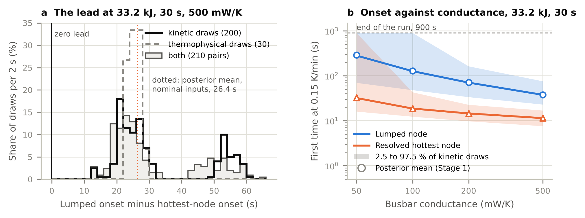

# Onset kinetics on a resolved neighbour cell: where a whole-cell threshold and a local one disagree

A pilot study. A published two-cell study (Satte 2026, doi:10.5281/zenodo.23253738) solved the neighbour of a failing LG M50 cell twice with identical inputs, as a single temperature (lumped) and as a resolved three-dimensional field, and compared both with fixed onset temperatures. This study replaces the fixed temperatures with decomposition kinetics: the posterior-mean B-CRNN kinetics of Koenig, Zhao and Deng (Chemical Engineering Journal 507 (2025) 160402), integrated along the archived temperature histories of the resolved hottest node, the resolved mean and the lumped node (Stage 1, passive), and then added as a heat source to both models (Stage 2, reactive, one-way). Stage 3 repeats Stage 1 over 200 draws of the kinetics' posterior and 30 draws of the roll's published thermal properties, to see which uncertainty sets each onset. Conduction and radiation only between the cells: the ejecta and flame paths are excluded. One geometry, the published two-cell case. This is onset in a neighbour, not propagation.

Siddharth Satte, Independent researcher, Pune, India.

Zenodo DOI, reserved for version v1.0.0: https://doi.org/10.5281/zenodo.23279456 (it resolves once the record is published). Cite as: Satte, S. (2026). Onset kinetics on a resolved neighbour cell: where a whole-cell threshold and a local one disagree (v1.0.0). Zenodo. https://doi.org/10.5281/zenodo.23279456

The one-page note is `note/neighbour_onset_note.pdf` (source `note/neighbour_onset_note.md`).

## Status and order of work

1. The published study was cloned at v1.0.0 (commit 2b35ac7); its archived series load, and the hottest node of the 33.2 kJ, 30 s, 500 mW/K case first reaches 456.65 K (183.5 C) between the 15.5 s and 16.0 s samples, at 15.51 s by linear interpolation, the published number.
2. Kinetics chosen and recorded (DECISIONS.md D1 to D12), driver filled (`src/onset_kinetics.py`), V0, V1 and V2 run on the source paper's cells and on synthetic histories only (commit 78c1321).
3. Predictions: `predictions.md`, commit `b09ef1d21a0281b543d0bf1f3b2c95f6cd5c2528`, first pushed to this public repository at 2026-10-10 08:09:37 UTC, when the main branch was created with b7ba0f5, a descendant of b09ef1d, as its head (the repository's activity log, `provenance/github_activity.json`; the repository was created at 08:09:05 UTC). That was before any kinetics were integrated along an archived history of the two-cell study. Its text has not changed since.
4. Stage 1 ran from 08:10:09 UTC, after the README recording that hash was pushed (08:10:02 UTC); its results and the scorecard of P1 to P4 were committed and pushed (commit 080e779, 08:17:13 UTC) before Stage 2 ran.
5. The Stage 2 scheme and checks (DECISIONS.md D13 to D15, commit b6ba9bd, pushed 08:17:23 UTC) were public before Stage 2 ran from 08:17:31 UTC.
6. Stage 2, the scoring of P5, the checks of D15, the figure and the note make up release v1.0.0. An independent review of that material, before release, led to D19 to D21: two exploratory analyses and fuller records. No registered result changed.
7. Stage 3, kinetic and thermophysical uncertainty (brief of 12 October): the 200 kinetic draws and their loader (D22, commit db29932); V4, the draws through the source paper's ARC test, failed under its registered acceptance (D23, commit f9cabc7) and was amended after the failure by the author's choice (D25, commit 1e835d9), under which it passes; the Stage 3a design (D26) and the predictions, `predictions_stage3.md`, commit `2657aeece0c2137af47aaae4abd9319bdd24ab40`, first pushed to this repository at 2026-10-12 13:01:52 UTC (`provenance/github_activity_stage3.json`), before any kinetic draw was integrated along an archived history of the two-cell study. Its text has not changed since. Stage 3a ran from 13:04 UTC, after the README recording that hash (commit 175cc17, 13:02:38 UTC) and the Stage 3a driver (302468b, 13:04:00 UTC) were pushed; the Stage 3b inputs and design (D27, commit c0d9a5e, 13:23:11 UTC) were public before Stage 3a finished. Stage 3a's results and the scoring of P1, P2, P3 and P6 were pushed (commit f8c08a3, 17:08:16 UTC) before any Stage 3b solve ran, and Stage 3b and 3c with P4 and P5 after (commit 9be6e40, 20:19:09 UTC).

## Results

Every number in the Results and Exploratory sections is computed from the result files by `src/note_numbers.py` (`results/note_numbers.json`), central estimates are quoted from `predictions.md`, and the Verification table quotes the check records it names.

Stage 1, passive kinetics along the archived histories (`results/onset_results.csv` and `.json`, 49 cases; `results/stage1_scorecard.json`):

1. Every history that self-heats at all first reaches 0.15 K/min at 108.39 to 108.42 C, by decomposition of the fresh SEI each history starts with. The same kinetics give T_in = 179.3 C in the source paper's ARC test only because its slow heat-wait-seek, about 25 h of it, consumes the SEI first (V1). How much rests on the fresh SEI is in the exploratory section below.
2. Copper busbars (500 mW/K in all) and 33.2 kJ: the resolved hottest node first self-heats at 0.15 K/min at 4.24 s and 11.48 s (10 and 30 s release), the lumped node at 27.60 s and 37.88 s, the resolved mean at 49.35 s and 59.38 s. The hottest node starts 23.4 s and 26.4 s before the lumped node (84.6 % and 69.7 % earlier).
3. The smallest busbar conductance at which only the hottest node starts is 100 mW/K (21.5 kJ, both releases); it also happens at 8.75 kJ and 500 mW/K.
4. The resolved mean starts in 10 of the 42 two-strip cases, the lumped node in 12 and the hottest node in 16. The hottest node reaches 10 K/min (first cathode reaction) in 6 cases, in 4 of which the lumped node never reaches 1 K/min; passively the lumped node peaks at 8.6 and 9.4 K/min at 33.2 kJ and 500 mW/K.

Stage 2, reaction heat fed back, one-way (`results/stage2_table.csv`, `results/stage2/`, `results/stage2_scorecard.json`):

5. At 33.2 kJ and 500 mW/K the hottest node enters the internal-short band (255.7 C) at 7.13 s and 19.23 s, at the same moment as without the reaction heat (7.13 s and 19.24 s in the two-cell study's passive runs): the entry is set by conduction from the busbar, not by the reaction. The reaction heat raises the hottest node's peak by 9.9 and 8.6 K (to 365.8 and 356.9 C), and a node's layered NCM cathode is 99 % consumed 1.3 s and 2.8 s after entry; at most 0.505 and 0.503 % of the cell's volume gets above 255.7 C. The resolved mean peaks 1.1 K higher (168.2 and 169.0 C).
6. The reactive lumped cell never enters the band: it peaks at 222.1 and 226.1 C (211.2 and 212.2 C without the source) and cools. It converts 51 and 63 % of its layered cathode, against 1.2 % over the resolved cell's volume, and releases 2.51 and 3.02 kJ of reaction heat, 6.0 and 7.1 times the resolved cell's 0.42 kJ: the lumped node, which holds the whole inventory at one temperature, peaks 44 K above the resolved mean even without the source.
7. At 33.2 kJ and 200 mW/K the reaction heat raises the hottest node's peak by only 0.6 and 0.7 K, to 251.4 and 251.5 C, short of the band, and the lumped cell's by 0.9 and 1.0 K, to 169.1 and 169.9 C. At 21.5 kJ, 500 mW/K and 30 s neither model enters the band (hottest node 236.8 C, lumped 152.9 C, each within 0.2 K of its passive peak). In these three runs the lumped cell releases 1.45 to 1.50 times the resolved cell's reaction heat.

| Prediction | Statement (short form) | Result | Measured |
|---|---|---|---|
| P1 | At 500 mW/K and 33.2 kJ the hottest node reaches 0.15 K/min more than half the lumped time earlier | Held | 4.24 s against 27.60 s (84.6 %) and 11.48 s against 37.88 s (69.7 %); central estimates 4.2 against 29 s and 11.5 against 39 s |
| P2 | The resolved mean reaches 0.15 K/min in exactly 10 named cases | Held | The same 10 cases; at 33.2 kJ and 50 mW/K the mean peaks at 107.0 and 107.3 C, just under 108.4 C |
| P3 | Smallest conductance with only the hottest node starting: 100 mW/K | Held | 100 mW/K (21.5 kJ), and 8.75 kJ at 500 mW/K, as predicted |
| P4 | The hottest node reaches 10 K/min where the lumped node stays under 1 K/min | Held | In the 4 predicted cases (33.2 kJ at 200 mW/K, 21.5 kJ at 500 mW/K, both releases) |
| P5(a) | Stage 2, 33.2 kJ and 500 mW/K: the resolved hottest region enters the internal-short band and the reactive lumped cell does not | Held, against the registered expectation | Entry at 7.13 s and 19.23 s (central estimate 7.1 and 19.0 s), at the same moment as without the reaction heat, so set by conduction; lumped peaks 222.1 and 226.1 C. The registered expectation was that P5(a) would fail on its lumped half (lumped runaway at about 170 and 180 s; about one chance in three of holding): wrong |
| P5(b) | Stage 2, 33.2 kJ and 200 mW/K: the hottest region is pushed into the band by its own reaction heat, the lumped cell stays out | Failed | The hottest node peaks at 251.4 and 251.5 C, 0.6 and 0.7 K above its passive peak (central estimate 5 to 10 K; registered odds about even); the lumped half held, 169.1 and 169.9 C, 0.9 and 1.0 K above passive (central estimate 4 K) |
| P5(c) | Stage 2, 21.5 kJ, 500 mW/K, 30 s: neither enters the band | Held | 236.8 C and 152.9 C, 0.17 and 0.20 K above passive (central estimates about 2 K and a few kelvin) |

## Stage 3: kinetic and thermophysical uncertainty

Stages 1 and 2 used one kinetic model, the posterior mean, and the published two-cell study's nominal properties. Stage 3 (brief of 12 October) asks how far the onsets and the lead move over the kinetic uncertainty that the source paper quantifies and over the published spread of the roll's thermal properties, and which of the two sets each onset. The predictions, `predictions_stage3.md` (commit 2657aee), were public before any draw met an archived history.

Design (DECISIONS.md D22 to D27):

- Kinetic draws (D22). 200 joint draws, each one particle from each of the three supplementary files of the source paper, the three indices sampled independently and uniformly (seed 20261012, `results/stage3_draw_indices.csv`); each draw is converted exactly as the mean model is, and no particle is scaled, trimmed, reweighted or corrected. The particle means reproduce the mean model to 1.1e-15.
- V4 (D23 to D25), every draw through the emulation of the source paper's ARC test. As registered, V4 failed: over the 164 draws in the paper's main cluster (82 %, against the paper's 76 %) the 2.5 and 97.5 percentiles of T_in were 146.3 and 191.4 C, against the paper's band of 169.0 to 198.0 C, though the mean, 178.8 C, lay within 5 C of the paper's 183.5 C. The study stopped and the failure was reported; the author then chose to amend V4 (D25, post hoc). Measured with the paper's own statistic (mean plus and minus two standard deviations, 161.9 to 195.7 C) and from the emulation's own T_in of the mean model (179.25 C, 4.25 C below the paper's mean since V1), the band's edges lie 2.8 and 2.0 C from the paper's, and V4 passes. `results/stage3_v4_amended.json` evaluates every combination of the two changes: none with absolute edges passes. 7.5 % of the draws short late and 10.5 % do not short, against the paper's 7 and 17 %.
- 3a (D26). Each draw is integrated along the archived histories exactly as in Stage 1: the brief's nine cases (33.2 kJ at 50 to 500 mW/K with both releases, and 21.5 kJ, 30 s, 500 mW/K) along all three histories, and the other 33 two-strip cases along the hottest-node and lumped histories, for P3 (the author's choice).
- 3b (D27). 30 Latin hypercube draws (seed 20261012) of the roll's conductivity across the layers (0.998 to 1.38 W/mK), along them (24.9 to 25.8 W/mK) and its specific heat (842 to 1110 J/(kg K)), spanning the values of O'Regan et al. (2022) for the M50's components and the jelly roll that Chen et al. (2021) measured in a 5 Ah NMC 21700 cell. The can-to-roll contact, the busbar strip conductance and the can's emissivity are held fixed: no range for this cell was found, and the published solver has no interface between can and roll. Each draw is one resolved and one lumped solve of the headline case with the published solver, followed by the mean kinetics along both histories.
- 3c. Each thermal draw is paired with 7 kinetic draws (210 pairs, `results/stage3c_pairs.csv`), each integrated along its thermal draw's histories.

Results, 3a (`results/stage3a_metrics.json`, `results/stage3a_onsets.csv`, `results/stage3a_per_draw.csv`):

8. The hottest node starts first in every draw in which any history starts, in all nine cases: kinetic uncertainty never reverses the order.
9. At 33.2 kJ, 30 s and 500 mW/K the hottest node starts between 7.6 and 17.0 s (2.5 to 97.5 %) and the lumped node between 23.1 and 75.9 s; the lead runs from 15.4 to 58.9 s, median 26.3 s (26.4 s under the mean model). All 200 draws start both nodes there.
10. The spread comes from the onset temperature. On the hottest node the draws start between 59.2 and 213.3 C (median 107.9 C); 81.5 % of the starts are SEI decomposition and the rest the first cathode reaction. 73 draws (36.5 %) start below 100 C, in every one of the nine cases, by SEI decomposition: the early-SEI behaviour that the source paper finds in its outliers.
11. The smallest conductance at which only the hottest node starts, over the 42 two-strip cases, spreads over the whole sweep: 5 mW/K in 3.5 % of draws, 20 mW/K in 13.5 %, 50 mW/K in 34 %, 100 mW/K in 21 %, 200 mW/K in 15.5 % and 500 mW/K in 10.5 %; 2 % have no such case.
12. The paper's outliers stay in every metric. At the headline case the 164 main-cluster draws start at a median of 11.2 s (hottest node) and 36.4 s (lumped), the 15 late-short draws at 16.3 and 69.2 s and the 21 no-short draws at 16.0 and 67.4 s; 41 % of the main-cluster draws, none of the late-short draws and 24 % of the no-short draws start below 100 C.

| Case | Hottest node, median (2.5 to 97.5 %), s | Lumped node, s | Lead, s | Only the hottest starts | SEI start | No onset |
|---|---|---|---|---|---|---|
| 33.2 kJ, 10 s, 500 mW/K | 4.2 (2.9 to 6.4) | 27.4 (13.0 to 66.1) | 23.2 (10.1 to 59.6) | 0 % | 73 % | 0 % |
| 33.2 kJ, 10 s, 200 mW/K | 5.6 (3.8 to 9.7) | 60.6 (23.4 to 154.7) | 55.0 (19.6 to 145.3) | 0 % | 81 % | 0 % |
| 33.2 kJ, 10 s, 100 mW/K | 7.6 (4.9 to 31.0) | 117.5 (37.9 to beyond 900) | 109.9 (33.0 to beyond) | 4.5 % | 100 % | 0 % |
| 33.2 kJ, 10 s, 50 mW/K | 20.8 (6.5 to beyond 900) | 276.8 (59.6 to beyond 900) | 206.9 (34.7 to beyond) | 24 % | 83 % | 17 % |
| 33.2 kJ, 30 s, 500 mW/K | 11.4 (7.6 to 17.0) | 37.7 (23.1 to 75.9) | 26.3 (15.4 to 58.9) | 0 % | 81.5 % | 0 % |
| 33.2 kJ, 30 s, 200 mW/K | 14.5 (9.8 to 22.7) | 70.5 (33.7 to 163.2) | 56.0 (23.9 to 141.1) | 0 % | 89 % | 0 % |
| 33.2 kJ, 30 s, 100 mW/K | 18.7 (12.4 to 43.1) | 126.8 (48.2 to beyond 900) | 108.1 (35.8 to beyond) | 4 % | 100 % | 0 % |
| 33.2 kJ, 30 s, 50 mW/K | 32.0 (16.1 to beyond 900) | 281.7 (70.0 to beyond 900) | 203.5 (38.0 to beyond) | 24.5 % | 84 % | 16 % |
| 21.5 kJ, 30 s, 500 mW/K | 14.0 (9.3 to 22.4) | 56.8 (28.4 to 159.1) | 42.8 (19.1 to 137.1) | 0 % | 90.5 % | 0 % |

"Beyond 900" marks a percentile that falls among draws in which that node does not start within the run; the lead is taken over the draws whose hottest node starts, a lumped node that does not start counting as the longest lead (D26).

Results, 3b and 3c (`results/stage3bc_metrics.json`, `results/stage3_thermal_draws.csv`, `results/stage3b_series/`):

13. Over the 30 thermal draws with the posterior-mean kinetics the hottest node starts between 11.3 and 11.6 s (2.5 to 97.5 %) and the lumped node between 34.1 and 39.8 s; the lead runs from 22.7 to 28.2 s. The lumped onset follows the roll's heat capacity almost exactly (correlation 0.9999 over the draws); the conductivities barely move either onset.
14. At 33.2 kJ, 30 s and 500 mW/K the standard deviation of the hottest-node onset is 2.83 s over the kinetic draws and 0.076 s over the thermal draws (thermal to kinetic 0.027); of the lumped onset 17.2 s and 1.82 s (0.106); of the lead 14.4 s and 1.75 s (0.121). Over the 210 combined pairs they are 2.79, 16.3 and 13.6 s; the combined variance is 3 to 13 % below the sum of the two single-factor variances, so there is no interaction. Over the published spread of the roll's properties, the kinetics set both onsets.
15. Of the 200 kinetic draws, the 37 whose hottest node starts by the first cathode reaction (at 196 to 217 C) make the second mode of the lead in Figure 2: 52.5 to 60.8 s, against 12.7 to 54.4 s for the 163 that start by SEI decomposition.

| Quantity, 33.2 kJ, 30 s, 500 mW/K | Kinetic draws (200), s | Thermal draws (30), s | Both (210 pairs), s | Thermal to kinetic, standard deviations |
|---|---|---|---|---|
| Hottest-node onset, 2.5 to 97.5 % (standard deviation) | 7.6 to 17.0 (2.83) | 11.3 to 11.6 (0.076) | 6.6 to 16.8 (2.79) | 0.027 |
| Lumped onset | 23.1 to 75.9 (17.2) | 34.1 to 39.8 (1.82) | 20.2 to 75.7 (16.3) | 0.106 |
| Lead | 15.4 to 58.9 (14.4) | 22.7 to 28.2 (1.75) | 13.6 to 58.9 (13.6) | 0.121 |

| Prediction (Stage 3) | Statement (short form) | Result | Measured |
|---|---|---|---|
| P1 | At 33.2 kJ, 30 s, 500 mW/K the hottest node starts first in over 95 % of kinetic draws | Held | 100 % (central estimates: brief 99 %, study 100 %) |
| P2 | There, the 95 % interval of the hottest-node onset is under 20 s and the lumped node's over 20 s | Held | 9.3 s (7.6 to 17.0 s) and 52.9 s (23.1 to 75.9 s); brief 8 and 40 s, study 9.2 and 64 s |
| P3 | The smallest only-local conductance is 100 mW/K in over half the draws and never above 200 mW/K | Failed on both counts | 21 % at 100 mW/K, and 500 mW/K in 21 draws (10.5 %); brief 70 %, study 18.5 % and 10.5 % |
| P4 | The thermal standard deviation of the hottest-node onset exceeds the kinetic one by over 1.5 times | Failed | Thermal to kinetic 0.027 (brief 3) |
| P5 | The kinetic standard deviation of the lumped onset exceeds the thermal one by over 1.5 times | Held | Kinetic to thermal 9.5 (brief 2) |
| P6 | Under 10 % of kinetic draws start below 100 C at the hottest node, the paper's early-SEI behaviour | Failed | 36.5 %, in every one of the nine cases (study 36.5 %) |

Figure 2 (`src/make_figure_stage3.py`). (a) The lead at 33.2 kJ, 30 s, 500 mW/K over the kinetic draws, the thermal draws and the combined pairs, with zero lead and the posterior-mean value marked. (b) The hottest-node and lumped onsets against busbar conductance at 33.2 kJ and 30 s: medians and the 2.5 to 97.5 % band over the kinetic draws, with Stage 1's posterior-mean onsets; a band that reaches the dashed line holds draws in which that node does not start within the 900 s run.

## Exploratory, not pre-registered (DECISIONS.md D19 and D20)

Fresh SEI (`src/explore_sei_storage.py`, `results/explore_sei_storage.json`). The mean model's SEI decomposes even at 25 C: stored there under the same kinetics, the neighbour loses 12 % of its SEI in a day, 36 % in three days, 80 % in a week and all of it in a month. Kinetics this slow are beyond what DSC data resolve, as the source paper's Appendix A notes; like the source's own ARC simulation, Stage 1 starts from a fresh SEI. Repeated from the stored states, at 33.2 kJ and 500 mW/K:

| SEI stored at 25 C | SEI gone | Hottest node starts (10 s, 30 s) | Lumped node starts (10 s, 30 s) | Lead |
|---|---|---|---|---|
| fresh (Stage 1) | 0 % | 4.24 s, 11.48 s at 108.4 C, SEI | 27.60 s, 37.88 s at 108.4 C, SEI | 23.4 s, 26.4 s |
| 3 days | 36 % | 4.31 s, 11.66 s at 111.3 C, SEI | 28.63 s, 38.90 s at 111.3 C, SEI | 24.3 s, 27.2 s |
| 7 days | 80 % | 6.20 s, 16.34 s at 210 and 201 C, first cathode reaction | 60.32 s, 70.23 s at 173 C, SEI | 54.1 s, 53.9 s |
| 30 days | 100 % | 6.21 s, 16.40 s at 211 and 202 C, first cathode reaction | 66.18 s, 75.91 s at 180 C, first cathode reaction | 60.0 s, 59.5 s |

With the SEI gone, at 33.2 kJ and 200 mW/K and at 21.5 kJ and 500 mW/K only the hottest node starts, and at 21.5 kJ and 100 mW/K nothing starts (all with the 30 s release). Wherever a history starts, the hottest node starts first, in every stored state; at 33.2 kJ and 500 mW/K the fresh SEI gives the shortest lead.

The source's own internal-short trigger. The source paper switches its internal short on when the rate of the battery's temperature rise surpasses 1 C/min (its Eq. 19, Table 1 and Section 3.2.2), which in its adiabatic calorimeter is the self-heating rate. A neighbour heated by conduction rises far faster than that from the busbar alone (up to 215 to 255 K/min at the lumped node and 1258 to 3305 K/min at the hottest node, 33.2 kJ and 500 mW/K), so here the trigger is applied to the kinetic self-heating only: the 1 K/min level of Stage 1. At 33.2 kJ and 500 mW/K the hottest node reaches it at 6.20 s and 16.36 s and the lumped node at 64.31 s and 74.09 s (177.7 and 177.9 C), 58.1 s and 57.7 s later. In 5 two-strip cases only the hottest node reaches it (33.2 kJ at 200 mW/K, both releases, and at 100 mW/K, 30 s; 21.5 kJ at 500 mW/K, both releases); the resolved mean reaches it in none. Read with that trigger, the reactive lumped cell of P5(a) would short too; P5 is scored on the brief's temperature band, as registered (D12).

## Verification

| Check | Result |
|---|---|
| V0, the source paper's DSC curves at 5 C/min | Cathode 0.49 W/g at 223.7 C and 0.15 W/g at 402 C (paper Fig. 3(a): about 0.50 at 223 C and 0.15 at 402 C); ln k of the three cathode reactions at 225, 275 and 410 C: -4.550, -4.310, -5.156 (Table 1 of the cathode source: -4.55, -4.31, -5.16); separator -0.079 W/g at 138.5 C (Fig. 3(e): -0.080 at 139 C), which fixes the sign of its heat (D5) |
| Fig. A.1(a) of the paper, read with `inputs/kinetics/digitize_figA1.py` | Its SEI curve between 25 and 60 C corresponds to an SEI mass of 99.4 g against Table 1's 100.58 g (a 1.2 % reading bias); its anode-electrolyte curve between 133 and 168 C to 205.5 g after that bias, the anode plus electrolyte mass of 208.58 g (D4) |
| V1, our emulation of the paper's ARC test of its own cell with the mean model (acceptance: T_in within the main-cluster two-sigma band, 169.0 to 198.0 C) | T_in = 179.3 C, pass (the paper's main-cluster mean, over its posterior samples, is 183.5 C); 179.2 to 186.6 C for 8 of 9 heat-wait-seek settings and 124.6 C for a 2 C/min ramp with a 5 min seek (an early SEI trigger, the paper's own outlier mechanism); 184.2 C with the anode alone as the anode-electrolyte mass |
| V1, T_on, the paper's internal-short trigger temperature (D6, D21; not part of the acceptance) | At the paper's stated trigger, 1 C/min: 199.8 C, 56 K below its main-cluster band of 255.7 to 302.1 C (mean 278.9 C), so this check fails. At 1 C/s: 272.7 C, inside the band. The paper gives 1 C/min in both its Table 1 and its Section 3.2.2; the cause of the mismatch is not resolved here |
| V2 before the predictions: synthetic holds, ramps of 0.3 to 30 K/s and pulses, tolerances, largest step and evaluation grid halved | Onset times move by at most 1.1e-4 of themselves (acceptance 1e-2) |
| V2 after Stage 1, archived headline cases (33.2 kJ, 500 mW/K, both releases) | At most 3.8e-6 |
| V3, energy account of every Stage 2 run at the published conductivity (the seven runs in `results/stage2/`) | Residual at most 1.35e-12 of the heat taken in (acceptance 1e-9) |
| V3, roll conductivity 1e4 W/mK, reactive resolved cell against the reactive lumped cell (acceptance 1 K) | 33.2 kJ, 30 s, 500 mW/K: mean within 0.47 K, hottest node within 0.77 K, peaks 225.7 and 226.1 C; 200 mW/K: mean within 0.045 K, hottest node within 0.36 K, both peaks 169.9 C; pass. Energy residuals of these two runs 7.9e-10 and 8.8e-10 |
| Stage 2 loops without the source, headline case | Reproduce the archived resolved series to 1.3e-12 K (hottest node) and 2.3e-13 K (mean), and the archived lumped node exactly |
| Stage 2 step check: the 1 K and 4 K limits of D13 halved, headline case (acceptance: no band-entry time moves by more than 1 %) | Band-entry times move by at most 7.5e-5 of themselves (255.7 C at 19.226 s and 19.225 s), pass; the hottest node's peak moves by 0.006 K, the reaction heat by 2e-6 of itself, the moment a node's layered cathode is consumed by one half step (22.025 s and 22.0125 s); the lumped node is unchanged to all digits |
| V0 to V2 re-run with the final code (the vectorised `rates()` that Stage 1 and Stage 2 use) | The committed records, kept unchanged, are reproduced to 6.4e-8 (V0), 2.4e-9 (V1 record) and 1.8e-8 (its trace), and 6e-15 (V2) of themselves (`results/rerun_final_code.json`, `src/compare_records.py`) |
| The mean model, `inputs/kinetics/bcrnn_mean_model.json` | Computed from the publisher's supplementary files in a browser session, because the machine this study ran on cannot reach the publisher's file server (`inputs/kinetics/SOURCE.md`). `extract_mean_model.py`, run on those files on 12 October (fetched again through the author's browser, every hash matching), reproduces it to 1.1e-15 (`results/extract_mean_model_check.txt`). V0's ln k values round to the cathode source's two-decimal values |
| V4, the 200 kinetic draws through the ARC emulation (D23 as registered: the 2.5 and 97.5 percentiles of the main-cluster T_in within 5 C of 169.0 and 198.0 C, the mean within 5 C of 183.5 C) | Failed: 146.3 and 191.4 C, mean 178.8 C, over the 164 main-cluster draws (82 %; the paper 76 %). The study stopped and the failure was reported (commit f9cabc7) |
| V4 as amended after the failure (D25, post hoc: the paper's own statistic, mean plus and minus two standard deviations, with the edges measured from the emulation's T_in of the mean model, 179.25 C) | Pass: 161.9 to 195.7 C, edges 2.8 and 2.0 C from the paper's, mean 4.7 C low. No variant with absolute edges passes (`results/stage3_v4_amended.json`) |
| V5, five kinetic draws on the nine cases with the tolerances, step limit and grid halved (acceptance 1e-2) | First times move by at most 6.7e-5 of themselves (194 compared), pass (`results/stage3a_v5.json`) |
| V6, the nominal inputs through the Stage 3b harness | Reproduce the archived series of the headline case exactly (0.0 K for the hottest node, the mean and the lumped node) |
| V6, energy account of the 30 Stage 3b solves (acceptance 1e-9) | Residual at most 6.3e-12 of the heat taken in, pass. The three high-conductivity reruns below close to 3.9e-9, 8.8e-10 and 2.3e-9 (Stage 2's high-conductivity runs of V3 closed to 7.9e-10 and 8.8e-10) |
| V6, roll conductivity 1e4 W/mK for the draws with the smallest, median and largest roll specific heat (acceptance 1 K) | Hottest node within 0.75 to 0.78 K and mean within 0.14 to 0.15 K of the lumped node at every archived time, pass |

## Contents

- `DECISIONS.md`: every analysis choice not fixed by the brief, with its reason, numbered; D13 to D15 were added after the predictions were public, before Stage 2 ran, and D16 to D21 after it (presentation, records and two exploratory analyses). Stage 3: D22 to D24 before V4 ran, D25 after it failed (post hoc, the author's choice), D26 with the Stage 3 predictions, D27 before any Stage 3b solve, and D28 after Stage 3 ran (presentation only).
- `predictions.md`: the pre-registered predictions and the hand reasoning behind them.
- `inputs/kinetics/`: the kinetics' source, hashes and page references (`SOURCE.md`), the posterior-mean parameters (`bcrnn_mean_model.json`, and readable as `bcrnn_mean_model_table.md` and `.csv`), the scripts that fetch the supplementary files, recompute the mean model and read Fig. A.1(a), and that reading (`figA1a_mass_basis.json`).
- `inputs/databank/`: the Battery Failure Databank rows behind the energies, with the Databank's notice (`SOURCE.md` says where they come from).
- `src/bcrnn.py`: the kinetic model. `src/onset_kinetics.py`: Stage 1, the brief's driver. `src/reactive.py`, `src/run_stage2.py`: Stage 2. `src/v0_dsc_check.py`, `src/v1_arc_check.py`, `src/v2_synthetic.py`, `src/v2_archived.py`, `src/v3_stage2.py`: the checks. `src/score_stage1.py`, `src/score_stage2.py`, `src/note_numbers.py`, `src/make_figure.py`: scoring, the quoted numbers and the figure. `src/explore_sei_storage.py`: the exploratory SEI analysis. `src/compare_records.py`: compares two sets of check records.
- `results/`: `onset_results.csv` and `.json` (Stage 1), `stage1_scorecard.json`, `stage2_table.csv`, `stage2_scorecard.json`, `stage2_checks.json`, `stage2/` (each Stage 2 run's record and time series), the check records (`v0_dsc_check.json`, `v1_arc_check.json` with `v1_arc_trace.csv`, `v2_synthetic.json`, `v2_archived.json`, `v3_stage2.json`, `rerun_final_code.json`), `explore_sei_storage.json`, `note_numbers.json`, `neighbour_onset_figure.png` and `.pdf`, and the run logs.
- `note/`: the note, its Markdown source, stylesheet and render script (pandoc and headless Chromium).
- `predictions_stage3.md`: the Stage 3 predictions, with the brief's and the study's central estimates.
- Stage 3 code: `src/stage3_draws.py` and `src/test_stage3_draws.py` (the kinetic draws and their unit test), `src/v4_arc_draws.py` and `src/v4_amended.py` (V4 as registered and as amended), `src/predictions_stage3_estimates.py` (the study's own central estimates, on synthetic ramps), `src/stage3a.py`, `src/stage3a_score.py` and `src/v5_tolerance.py` (Stage 3a, its scoring and V5), `src/stage3b.py` and `src/stage3bc_score.py` (Stages 3b and 3c, V6 and the decomposition), `src/stage3_numbers.py` (every quoted Stage 3 number, `results/stage3_numbers.json`) and `src/make_figure_stage3.py` (Figure 2).
- Stage 3 results: `stage3_draw_indices.csv`, `stage3_draws.json`, `stage3_v4_arc_draws.csv`, `stage3_v4.json`, `stage3_v4_amended.json`, `stage3_prediction_estimates.json`, `stage3a_onsets.csv`, `stage3a_metrics.json`, `stage3a_per_draw.csv`, `stage3a_p3_by_draw.csv`, `stage3a_v5.json`, `stage3_thermal_draws.csv`, `stage3c_pairs.csv`, `stage3b_design.json`, `stage3b_nominal_check.json`, `stage3b_solves.jsonl`, `stage3b_series/`, `stage3bc_onsets.csv`, `stage3bc_metrics.json`, `stage3_scorecard.json`, `stage3_numbers.json`, `stage3_figure.png` and `.pdf`, and the run logs. The draws' parameter vectors (`stage3_kinetic_draw_parameters.csv`) reproduce the publisher's data and are not included: `stage3_draws.py` regenerates them from the publisher's files, and their SHA-256 is in `stage3_draws.json`.
- `provenance/github_activity.json`: the repository's push log before the release push (GitHub activity API); `provenance/github_activity_stage3.json`: the push log after the Stage 3 predictions.

## Running

Python 3.11 or newer. `pip install -r requirements.txt`, then `./get_published_study.sh` (clones the published study at v1.0.0 into `external/`, where the scripts find its archived series and its solver). From `src/`, with `MKL_NUM_THREADS=1`:

    python3 v0_dsc_check.py --out ../results
    python3 v1_arc_check.py --out ../results --sensitivity
    python3 v2_synthetic.py --out ../results
    python3 onset_kinetics.py --series ../external/m50-two-cell-pilot/results/resolved_series --out ../results
    python3 score_stage1.py --out ../results
    python3 v2_archived.py --out ../results
    python3 run_stage2.py --out ../results --cases max:30:0.5 max:30:0.2 median:30:0.5
    python3 run_stage2.py --out ../results --cases max:10:0.5 max:10:0.2
    python3 run_stage2.py --out ../results --cases max:30:0.5 --no-reaction --tag _no_source
    python3 run_stage2.py --out ../results --cases max:30:0.5 --dt-scale 0.5 --tag _step_halved
    python3 v3_stage2.py --out ../results --cases max:30:0.5 max:30:0.2
    python3 score_stage2.py --out ../results
    python3 explore_sei_storage.py --out ../results
    python3 note_numbers.py --out ../results
    python3 make_figure.py --out ../results
    python3 stage3_draws.py --out ../results
    python3 test_stage3_draws.py
    python3 v4_arc_draws.py --out ../results --jobs 2
    python3 v4_amended.py --out ../results
    python3 predictions_stage3_estimates.py --series ../external/m50-two-cell-pilot/results/resolved_series --out ../results
    python3 stage3a.py --series ../external/m50-two-cell-pilot/results/resolved_series --out ../results --jobs 2
    python3 stage3a.py --series ../external/m50-two-cell-pilot/results/resolved_series --out ../results --merge
    python3 stage3a_score.py --out ../results
    python3 v5_tolerance.py --series ../external/m50-two-cell-pilot/results/resolved_series --out ../results
    python3 stage3b.py --out ../results design
    python3 stage3b.py --out ../results nominal
    python3 stage3b.py --out ../results solve --jobs 2
    python3 stage3b.py --out ../results kinetics --jobs 2
    python3 stage3bc_score.py --out ../results
    python3 stage3_numbers.py --out ../results
    python3 make_figure_stage3.py --out ../results
    cd ../note && ./render_note.sh

To compare a re-run of V0 to V2 with the committed records, run those three scripts with `--out` set to another folder, then `python3 compare_records.py --a ../results --b <that folder> --files v0_dsc_check.json v1_arc_check.json v1_arc_trace.csv v2_synthetic.json --out ../results/rerun_final_code.json`.

To recompute the kinetic parameters from the publisher's files: `python3 inputs/kinetics/fetch_supplementary.py`, then `python3 inputs/kinetics/extract_mean_model.py`. Stage 3 needs those files in `inputs/kinetics/supplementary/` (their hashes are in `inputs/kinetics/SOURCE.md`). PARDISO (`pypardiso`, which needs MKL) is used for the sparse solves when installed; SuperLU is the fallback.

## Sources and credits

- B.C. Koenig, P. Zhao, S. Deng, Comprehensive thermal-kinetic uncertainty quantification of lithium-ion battery thermal runaway via Bayesian chemical reaction neural networks, Chemical Engineering Journal 507 (2025) 160402, doi:10.1016/j.cej.2025.160402, and its supplementary material (the trained B-CRNN particles), which is not redistributed here.
- S. Satte, Where and when a neighbour cell first reaches thermal-runaway onset temperatures: resolved against lumped, a pre-registered two-cell LG M50 pilot (v1.0.0), Zenodo (2026), doi:10.5281/zenodo.23253738: the archived temperature histories, the resolved and lumped solvers, the cell properties and the Battery Failure Databank energies.
- K. O'Regan, F. Brosa Planella, W.D. Widanage, E. Kendrick, Thermal-electrochemical parameters of a high energy lithium-ion cylindrical battery, Electrochimica Acta 425 (2022) 140700, doi:10.1016/j.electacta.2022.140700: the M50's component conductivities and heat capacities behind the nominal roll properties and one end of each Stage 3b range (read in the authors' accepted manuscript, WRAP 196287).
- H. Chen, J.E.H. Buston, J. Gill, D. Howard, R.C.E. Williams, E. Read, A. Abaza, B. Cooper, J.X. Wen, A simplified mathematical model for heating-induced thermal runaway of lithium-ion batteries, Journal of The Electrochemical Society 168 (2021) 010502, doi:10.1149/1945-7111/abd64c: the measured jelly roll of a 5 Ah NMC 21700 cell at the other end of the Stage 3b ranges (accepted manuscript, WRAP 146838).
- A. Gaitonde, A. Nimmagadda, A. Marconnet, Experimental characterization of thermal conductance across the separator-shell interface in dry cylindrical lithium ion batteries, ITHERM 2017, doi:10.1109/ITHERM.2017.7992602: the only published can-to-roll contact values found (dry samples in 18650 cans), cited where that contact is held fixed.
- Battery Failure Databank, revision 2 (February 2024), National Renewable Energy Laboratory (now National Laboratory of the Rockies), U.S. Department of Energy; described in D.P. Finegan et al., Journal of Power Sources 597 (2024) 234106. The energies here (8.75, 21.5 and 33.2 kJ through the cell body) come from it through the two-cell study's archived histories; the rows used are copied unchanged from that study into `inputs/databank/` with the Databank's notice, which must accompany every copy (`inputs/databank/SOURCE.md`). The Battery Failure Databank is provided by the U.S. Department of Energy's National Renewable Energy Laboratory, operated by Alliance for Sustainable Energy, LLC (DOE/NREL/ALLIANCE); its notice accompanies the rows used, in `inputs/databank/`.

## Licence

The code is under the MIT licence (LICENSE). The note, the figure and the result files are under CC BY 4.0 (https://creativecommons.org/licenses/by/4.0/). The Databank rows remain under the Databank's own notice (`inputs/databank/DATABANK_NOTICE.txt`), which accompanies every copy.
