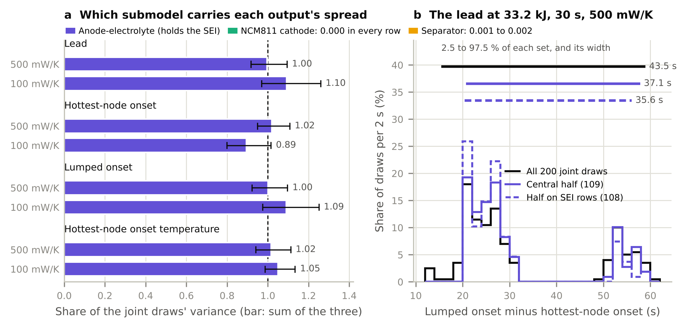
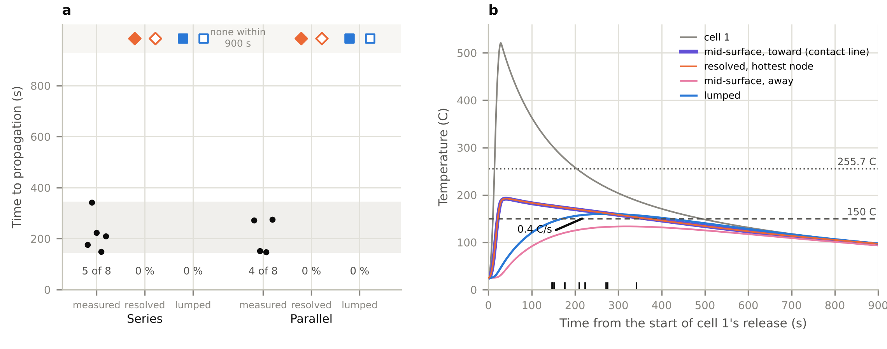
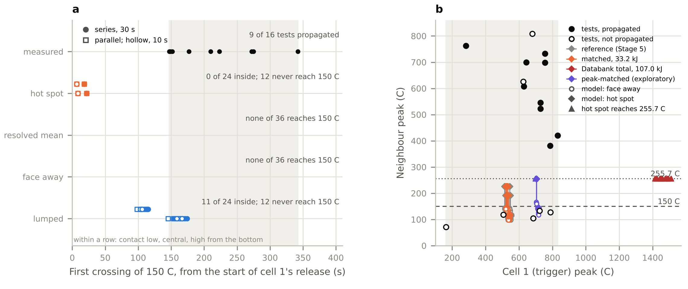
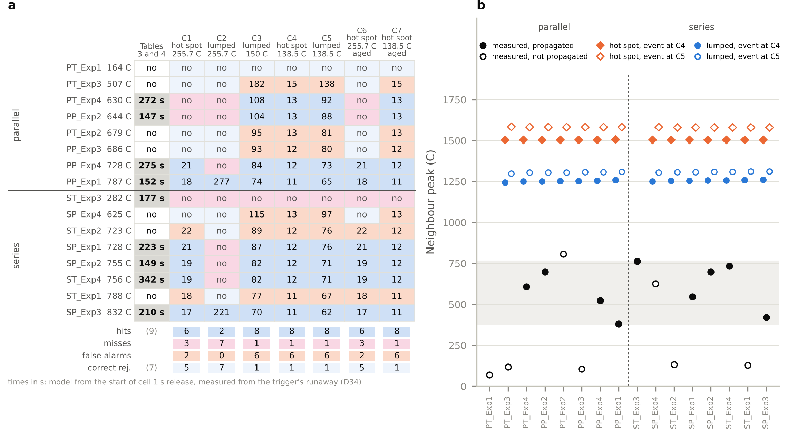

# Onset kinetics on a resolved neighbour cell: where a whole-cell threshold and a local one disagree

A pilot study. A published two-cell study (Satte 2026, doi:10.5281/zenodo.23253738) solved the neighbour of a failing LG M50 cell twice with identical inputs, as a single temperature (lumped) and as a resolved three-dimensional field, and compared both with fixed onset temperatures. This study replaces the fixed temperatures with decomposition kinetics: the posterior-mean B-CRNN kinetics of Koenig, Zhao and Deng (Chemical Engineering Journal 507 (2025) 160402), integrated along the archived temperature histories of the resolved hottest node, the resolved mean and the lumped node (Stage 1, passive), and then added as a heat source to both models (Stage 2, reactive, one-way). Stage 3 repeats Stage 1 over 200 draws of the kinetics' posterior and 30 draws of the roll's published thermal properties, to see which uncertainty sets each onset. Stage 4 (version 1.1.0) varies each of the posterior's three submodels alone over the same draws, to see which one carries the spread of the lead and what tightening it would buy. Stage 5 (version 1.2.0) puts the cans in contact, joins them by welded tabs and sets both neighbours against the measured two-cell propagation tests of Fransson et al. (Journal of Power Sources 617 (2024) 234916). Conduction and radiation only between the cells: venting, ejecta and flame are excluded. Stages 1 to 4 use one geometry, the published two-cell case, and concern onset in a neighbour, not propagation; Stage 5 asks whether the neighbour propagates. Stage 6, in the same version, applies the paper's 150 C criterion to the Stage 5 runs and gives the trigger the durations and peaks the tests measured, to see why the model does not propagate where the tests did. Stage 7 (version 1.3.0) scores the model test by test: each of the sixteen tests gets its own trigger, seven candidate ignition conditions are read from the runs with a fresh and an aged SEI and scored against the measured outcomes, and the internal short is run as an event, the neighbour's stored electrical energy released when its separator melts.

Siddharth Satte, Independent researcher, Pune, India.

All versions on Zenodo: https://doi.org/10.5281/zenodo.23279455. The DOI of this version, v1.3.0, is reserved when its Zenodo draft is made, which Zenodo allows only once the draft of v1.2.0 is published (D72). Version v1.2.0, reserved: https://doi.org/10.5281/zenodo.23589793 (it resolves once that record is published); v1.1.0: https://doi.org/10.5281/zenodo.23279456; v1.0.0 was released on GitHub only. Cite as: Satte, S. (2026). Onset kinetics on a resolved neighbour cell: where a whole-cell threshold and a local one disagree (v1.3.0). Zenodo. https://doi.org/10.5281/zenodo.23279455

The note is `note/neighbour_onset_note.pdf`, two pages since Stage 7 (source `note/neighbour_onset_note.md`).

## Status and order of work

1. The published study was cloned at v1.0.0 (commit 2b35ac7); its archived series load, and the hottest node of the 33.2 kJ, 30 s, 500 mW/K case first reaches 456.65 K (183.5 C) between the 15.5 s and 16.0 s samples, at 15.51 s by linear interpolation, the published number.
2. Kinetics chosen and recorded (DECISIONS.md D1 to D12), driver filled (`src/onset_kinetics.py`), V0, V1 and V2 run on the source paper's cells and on synthetic histories only (commit 78c1321).
3. Predictions: `predictions.md`, commit `b09ef1d21a0281b543d0bf1f3b2c95f6cd5c2528`, first pushed to this public repository at 2026-10-10 08:09:37 UTC, when the main branch was created with b7ba0f5, a descendant of b09ef1d, as its head (the repository's activity log, `provenance/github_activity.json`; the repository was created at 08:09:05 UTC). That was before any kinetics were integrated along an archived history of the two-cell study. Its text has not changed since.
4. Stage 1 ran from 08:10:09 UTC, after the README recording that hash was pushed (08:10:02 UTC); its results and the scorecard of P1 to P4 were committed and pushed (commit 080e779, 08:17:13 UTC) before Stage 2 ran.
5. The Stage 2 scheme and checks (DECISIONS.md D13 to D15, commit b6ba9bd, pushed 08:17:23 UTC) were public before Stage 2 ran from 08:17:31 UTC.
6. Stage 2, the scoring of P5, the checks of D15, the figure and the note were completed on 10 October (commit f34f408). An independent review of that material led to D19 to D21: two exploratory analyses and fuller records. No registered result changed. Release v1.0.0 holds Stages 1 to 3.
7. Stage 3, kinetic and thermophysical uncertainty (brief of 12 October): the 200 kinetic draws and their loader (D22, commit db29932); V4, the draws through the source paper's ARC test, failed the brief's acceptance as D23 set it out (commit 1385a30, before V4 ran; D22 to D24 were first pushed together with the failure, commit f9cabc7), after a numerical fix to the emulation made when its first run broke down on 13 draws (D24, commit 10e25b7), and was amended after the failure by the author's choice (D25, commit 1e835d9), under which it passes; the Stage 3a design (D26) and the predictions, `predictions_stage3.md`, commit `2657aeece0c2137af47aaae4abd9319bdd24ab40`, first pushed to this repository at 2026-10-12 13:01:52 UTC (`provenance/github_activity_stage3.json`), before any kinetic draw was integrated along an archived history of the two-cell study. Its text has not changed since. Stage 3a ran from 13:04 UTC, after the README recording that hash (commit 175cc17, 13:02:38 UTC) and the Stage 3a driver (302468b, 13:04:00 UTC) were pushed; the Stage 3b inputs and design (D27, commit c0d9a5e, 13:23:11 UTC) were public before Stage 3a finished. Stage 3a's results and the scoring of P1, P2, P3 and P6 were pushed (commit f8c08a3, 17:08:16 UTC) before any Stage 3b solve ran, and Stage 3b and 3c with P4 and P5 after (commit 9be6e40, 20:19:09 UTC).
8. Stage 4, which submodel of the kinetic posterior sets the lead (brief of 16 October; version 1.1.0).
   - The step 1 checks (V7) passed.
   - The design (D29) and the predictions, `predictions_v11.md`, commit `a975f20c63cd823d932983ddf285b5782b0ca31c`, were first pushed to this repository at 2026-10-16 07:08:24 UTC (`provenance/github_activity_stage4.json`). That was before any grouped run, and the file's text has not changed since.
   - The 600 grouped draws ran from 07:08:47 to 07:31:39 UTC. Their records, the scoring of P1 to P5 and the exploratory analyses written after the results (D30) were pushed in commit 18f184f (07:39:19 UTC).
   - An independent check of the Stage 4 documents (D32) recomputed every Stage 4 quantity and reproduced every registered number and verdict. It led to corrections of their wording, one erratum in the predictions' background and one more exploratory analysis (D30 (4)); no registered result changed.
   - Release v1.1.0 adds Stage 4. No v1.0.0 result changes.
9. Stage 5, the resolved and the lumped neighbour against measured two-cell propagation (brief of 21 October; version 1.2.0).
   - The Stage 5 model, harness and scoring script, with the checks before the predictions (V1, V2 and the compiled reaction step; D41 and D44), which passed, were pushed first (commit 03af770); the predictions commit made the harness's time limits work on Windows.
   - The design (D33 to D44) and the predictions, `predictions_v12.md`, commit `b4883baeac2220b117cd66c28bd8d38dde2d5d62`, were first pushed to this repository at 2026-10-21 17:22:38 UTC (`provenance/github_activity_stage5.json`). That was before any Stage 5 run, and the file's text has not changed since.
   - The registered runs went from 2026-10-21 18:08:04 UTC to 2026-10-23 10:39:35 UTC, on the author's laptop and, for 768 fact runs, on a two-core cloud machine. The decisions added after the predictions (D45 to D47: where the runs were made, how the two machines share them, and the runs that failed for want of memory) were each pushed before the registered scoring (`provenance/github_activity_stage5_runs.json`), and none of them changes what a run computes or how it is scored.
   - The merged records, the scoring of P1 to P7, the quoted numbers, Figure 4 and D48 (presentation, records and the exploratory analyses, written after the results) were pushed in commit bd1303b. After the independent check (V4, D49), the corrected `src/v12_numbers.py` and `results/v12_numbers.json`, the reworded D48 (1) and (2) and the texts were pushed in commit 5053b2f.
   - V4, an independent read of every registered Stage 5 number and verdict, was made before the note's Stage 5 lines were finalised (D49).
   - Release v1.2.0 adds Stages 5 and 6 (item 10). No v1.1.0 result changes.
10. Stage 6, why the model does not propagate where the tests did (brief of 24 October; in version 1.2.0, D58).
   - The design (D50 to D59), the code, and its tests on synthetic inputs only (D56 (4)) were pushed with the predictions, `predictions_stage6.md`, commit `c9586a8718172d6f545a47e37e104a41d71965ee` (the design is its parent, 44c9e3a), first pushed to this repository at 2026-10-23 20:11:24 UTC (`provenance/github_activity_stage6.json`). That was before any Stage 6 quantity was computed: no Part A crossing, no Stage 6 history of cell 1, no run of the neighbour in the Stage 6 configuration. The file's text has not changed since. It records, prediction by prediction, what Stage 5's published records already fixed.
   - The selection of the matched case and the exploratory energy (D60), Part A, V1 and V2 were computed after that push and pushed in commit b38568c (20:13:21 UTC), before any run of the neighbour (`provenance/github_activity_stage6_runs.json`).
   - The 506 runs went from 2026-10-24 00:02:41 to 03:52:01 UTC, on the author's laptop; none failed. The records, the scoring of P1 to P7, the quoted numbers, Figure 5 and D61 were pushed in commit 7703d58 (04:09:35 UTC). The commits pushed while the runs went (5e8bdb4, 6d78ff5, 6ac3b39) add the numbers script, correct a citation (D59) and adjust the figure; none touches what a run computes or how it is scored.
   - An independent read of every registered Stage 6 number and verdict was made before the note's Stage 6 lines were finalised (D62). After it, the corrected texts, two more blocks of quoted numbers in `src/stage6_numbers.py` and `results/stage6_numbers.json`, D61 (4) reworded in place and D62 were pushed in commit 6cc799a; a second pass on them found three more problems, corrected in the commit that follows it (D62 (5)).
11. Stage 7, the ignition condition scored test by test (brief of 26 October; version 1.3.0, D72).
   - The design (D63 to D73), the code, and its tests on synthetic inputs only (D70 (4)) were pushed with the predictions, `predictions_stage7.md`, commit `714b1fd1161166322977e574bd75234cdbb2c5c0` (the design is its parent, 80c91ad), first pushed to this repository at 2026-10-26 05:48:11 UTC (`provenance/github_activity_stage7.json`). That was before any Stage 7 run: no Stage 7 trigger energy, no history of cell 1 for a Stage 7 trigger, no run of the neighbour in a Stage 7 configuration. To size the runs, one event run with cell 1 held at the ambient temperature, outside every Stage 7 configuration, was computed twice before them, first with D13's sub-step limit (stopped once its cost was clear) and then with the Part C settings (`provenance/stage7_cost_test.json`, D70 (4)). The file's text has not changed since. It records, prediction by prediction, what the earlier stages' records and an energy balance already fixed.
   - The sixteen trigger energies, the peak-to-energy table, the separator's spread and V1 (D74) were computed after that push and pushed in commit 1871d3f (05:52:17 UTC), before any run of the neighbour.
   - The 186 runs went from 2026-10-26 05:54:53 to 07:15:59 UTC, on the author's laptop; none failed. The workers wrote the Part C list (58 runs) once every pertest run had ended (D75 (2)). The records of 185 runs, the scoring of P1 to P8, the quoted numbers and Figure 6 were pushed in commit 6f0d2de (07:06:17 UTC) while V3's refined run went, and the complete results in 32b02fb (07:17:58 UTC) (`provenance/github_activity_stage7_runs.json`). The two commits before them (27bef4e and 3c57255) correct the scoring script's Part C rows and its check that an event run repeats its Part A run (D75 (3)); neither touches a verdict.
   - An independent read of every registered Stage 7 number and verdict was made before the note's Stage 7 lines were written (D76); the corrections it led to were pushed with the texts.
   - Release v1.3.0 adds Stage 7. No v1.2.0 result changes.

## Results

Every number in the Results and Exploratory sections is computed from the result files by `src/note_numbers.py` (`results/note_numbers.json`), central estimates are quoted from `predictions.md`, and the Verification table quotes the check records it names.

Stage 1, passive kinetics along the archived histories (`results/onset_results.csv` and `.json`, 49 cases; `results/stage1_scorecard.json`):

1. Every history that self-heats at all first reaches 0.15 K/min at 108.39 to 108.42 C, by decomposition of the fresh SEI each history starts with. The same kinetics give T_in = 179.3 C in the source paper's ARC test only because its slow heat-wait-seek, about 25 h of it, consumes the SEI first (V1). How much rests on the fresh SEI is in the exploratory section below.
2. Copper busbars (500 mW/K in all) and 33.2 kJ: the resolved hottest node first self-heats at 0.15 K/min at 4.24 s and 11.48 s (10 and 30 s release), the lumped node at 27.60 s and 37.88 s, the resolved mean at 49.35 s and 59.38 s. The hottest node starts 23.4 s and 26.4 s before the lumped node (84.6 % and 69.7 % earlier).
3. The smallest busbar conductance at which only the hottest node starts is 100 mW/K (21.5 kJ, both releases); it also happens at 8.75 kJ and 500 mW/K.
4. The resolved mean starts in 10 of the 42 two-strip cases, the lumped node in 12 and the hottest node in 16. The hottest node reaches 10 K/min (first cathode reaction) in 6 cases, in 4 of which the lumped node never reaches 1 K/min; passively the lumped node peaks at 8.6 and 9.4 K/min at 33.2 kJ and 500 mW/K.

Stage 2, reaction heat fed back, one-way (`results/stage2_table.csv`, `results/stage2/`, `results/stage2_scorecard.json`):

5. At 33.2 kJ and 500 mW/K the hottest node enters the internal-short band (255.7 C) at 7.13 s and 19.23 s, at the same moment as without the reaction heat (7.13 s and 19.24 s in the two-cell study's passive runs): the entry is set by conduction from the busbar, not by the reaction. The reaction heat raises the hottest node's peak by 9.9 and 8.6 K (to 365.8 and 356.9 C), and a node's layered NCM cathode is 99 % consumed 1.3 s and 2.8 s after entry; at most 0.505 and 0.503 % of the cell's volume gets above 255.7 C. The resolved mean peaks 1.1 K higher (168.2 and 169.0 C).
6. The reactive lumped cell never enters the band: it peaks at 222.1 and 226.1 C (211.2 and 212.2 C without the source) and cools. It converts 51 and 63 % of its layered cathode, against 1.2 % over the resolved cell's volume, and releases 2.51 and 3.02 kJ of reaction heat, 6.0 and 7.1 times the resolved cell's 0.42 kJ: the lumped node, which holds the whole inventory at one temperature, peaks 44 K above the resolved mean even without the source.
7. At 33.2 kJ and 200 mW/K the reaction heat raises the hottest node's peak by only 0.6 and 0.7 K, to 251.4 and 251.5 C, short of the band, and the lumped cell's by 0.9 and 1.0 K, to 169.1 and 169.9 C. At 21.5 kJ, 500 mW/K and 30 s neither model enters the band (hottest node 236.8 C, lumped 152.9 C, each within 0.2 K of its passive peak). In these three runs the lumped cell releases 1.45 to 1.50 times the resolved cell's reaction heat.

| Prediction | Statement (short form) | Result | Measured |
|---|---|---|---|
| P1 | At 500 mW/K and 33.2 kJ the hottest node reaches 0.15 K/min more than half the lumped time earlier | Held | 4.24 s against 27.60 s (84.6 %) and 11.48 s against 37.88 s (69.7 %); central estimates 4.2 against 29 s and 11.5 against 39 s |
| P2 | The resolved mean reaches 0.15 K/min in exactly 10 named cases | Held | The same 10 cases; at 33.2 kJ and 50 mW/K the mean peaks at 107.0 and 107.3 C, just under 108.4 C |
| P3 | Smallest conductance with only the hottest node starting: 100 mW/K | Held | 100 mW/K (21.5 kJ), and 8.75 kJ at 500 mW/K, as predicted |
| P4 | The hottest node reaches 10 K/min where the lumped node stays under 1 K/min | Held | In the 4 predicted cases (33.2 kJ at 200 mW/K, 21.5 kJ at 500 mW/K, both releases) |
| P5(a) | Stage 2, 33.2 kJ and 500 mW/K: the resolved hottest region enters the internal-short band and the reactive lumped cell does not | Held, against the registered expectation | Entry at 7.13 s and 19.23 s (central estimate 7.1 and 19.0 s), at the same moment as without the reaction heat, so set by conduction; lumped peaks 222.1 and 226.1 C. The registered expectation was that P5(a) would fail on its lumped half (lumped runaway at about 170 and 180 s; about one chance in three of holding): wrong |
| P5(b) | Stage 2, 33.2 kJ and 200 mW/K: the hottest region is pushed into the band by its own reaction heat, the lumped cell stays out | Failed | The hottest node peaks at 251.4 and 251.5 C, 0.6 and 0.7 K above its passive peak (central estimate 5 to 10 K; registered odds about even); the lumped half held, 169.1 and 169.9 C, 0.9 and 1.0 K above passive (central estimate 4 K) |
| P5(c) | Stage 2, 21.5 kJ, 500 mW/K, 30 s: neither enters the band | Held | 236.8 C and 152.9 C, 0.17 and 0.20 K above passive (central estimates about 2 K and a few kelvin) |

## Stage 3: kinetic and thermophysical uncertainty

Stages 1 and 2 used one kinetic model, the posterior mean, and the published two-cell study's nominal properties. Stage 3 (brief of 12 October) asks how far the onsets and the lead move over the kinetic uncertainty that the source paper quantifies and over the published spread of the roll's thermal properties, and which of the two sets each onset. The predictions, `predictions_stage3.md` (commit 2657aee), were public before any draw met an archived history.

Design (DECISIONS.md D22 to D27):

- Kinetic draws (D22). 200 joint draws, each one particle from each of the three supplementary files of the source paper, the three indices sampled independently and uniformly (seed 20261012, `results/stage3_draw_indices.csv`); each draw is converted exactly as the mean model is, and no particle is scaled, trimmed, reweighted or corrected. The particle means reproduce the mean model to 1.1e-15.
- V4 (D23 to D25), every draw through the emulation of the source paper's ARC test. Under the brief's acceptance, as D23 set it out before V4 ran, V4 failed: over the 164 draws in the main cluster by D23's rule (a short within 4000 min; 82 % of the draws, against the paper's 76 %) the 2.5 and 97.5 percentiles of T_in were 146.3 and 191.4 C, against the paper's band of 169.0 to 198.0 C, though the mean, 178.8 C, lay within 5 C of the paper's 183.5 C. The study stopped and the failure was reported; the author then chose to amend V4 (D25, post hoc, written after a diagnosis that showed which variants pass). Measured with the paper's own statistic (mean plus and minus two standard deviations, 161.9 to 195.7 C) and from the emulation's own T_in of the mean model (179.25 C, 4.25 C below the paper's mean since V1), the band's edges lie 2.8 and 2.0 C from the paper's and the mean 4.7 C below it (limit 5 C), and V4 passes. `results/stage3_v4_amended.json` evaluates every combination of the two changes: none with absolute edges passes. 7.5 % of the draws have a delayed short (the paper's late short) and 10.5 % no short, against the paper's 7 and 17 %.
- 3a (D26). Each draw is integrated along the archived histories exactly as in Stage 1: the brief's nine cases (33.2 kJ at 50 to 500 mW/K with both releases, and 21.5 kJ, 30 s, 500 mW/K) along all three histories, and the other 33 two-strip cases along the hottest-node and lumped histories, for P3 (the author's choice).
- 3b (D27). 30 Latin hypercube draws (seed 20261012) of the roll's conductivity across the layers (0.998 to 1.38 W/mK), along them (24.9 to 25.8 W/mK) and its specific heat (842 to 1110 J/(kg K)), spanning the jelly roll that Chen et al. (2021) measured in a 5 Ah NMC 21700 cell and the values that O'Regan et al. (2022) give for the M50's components. The O'Regan ends of the ranges are the two-cell study's own combinations of those component values over 25 to 100 C (its D3), not values printed by O'Regan et al., who warn that such combinations do not give the cell's conductivity; the page numbers of their published paper remain to be checked (it was read in the accepted manuscript). Held fixed: the busbar strip conductance and the can's emissivity, for which no published range was found, and the can-to-roll contact. For the contact the brief asked for a published range for cylindrical cells, and one exists only for dry samples in 18650 cans (Gaitonde et al. 2017); it is held at the published solver's perfect contact because the solver has no interface between can and roll, a deviation from the brief. Each draw is one resolved and one lumped solve of the headline case with the published solver, followed by the mean kinetics along both histories.
- 3c. Each thermal draw is paired with 7 kinetic draws (210 pairs, `results/stage3c_pairs.csv`), each integrated along its thermal draw's histories.

Results, 3a (`results/stage3a_metrics.json`, `results/stage3a_onsets.csv`, `results/stage3a_per_draw.csv`):

8. The hottest node starts first in every draw in which any history starts, in all nine cases, and over all 42 two-strip cases the lumped node never starts at or before the hottest node: kinetic uncertainty never reverses the order.
9. At 33.2 kJ, 30 s and 500 mW/K the hottest node starts between 7.6 and 17.0 s (2.5 to 97.5 %) and the lumped node between 23.1 and 75.9 s; the lead runs from 15.4 to 58.9 s, median 26.3 s (26.4 s under the mean model). All 200 draws start both nodes there.
10. The spread comes from the onset temperature. On the hottest node the draws start between 59.2 and 213.3 C (2.5 to 97.5 %; all draws 45.2 to 216.6 C, median 107.9 C); 81.5 % of the starts are SEI decomposition and the rest the first cathode reaction. The same 73 draws (36.5 %) start below 100 C in every one of the nine cases, by SEI decomposition, the start that P6 counts; 68 of them are in V4's main cluster, 5 among the draws without a short and none among the delayed shorts.
11. The smallest conductance at which only the hottest node starts, over the 42 two-strip cases, spreads over six of the sweep's seven conductances (no draw has 10 mW/K): 5 mW/K in 3.5 % of draws, 20 mW/K in 13.5 %, 50 mW/K in 34 %, 100 mW/K in 21 %, 200 mW/K in 15.5 % and 500 mW/K in 10.5 %; 2 % have no such case.
12. The draws in the paper's outlier classes stay in every metric. At the headline case the 164 main-cluster draws start at a median of 11.2 s (hottest node) and 36.4 s (lumped), the 15 delayed-short draws at 16.3 and 69.2 s and the 21 no-short draws at 16.0 and 67.4 s; 41 % of the main-cluster draws, none of the delayed-short draws and 24 % of the no-short draws start below 100 C.

| Case | Hottest node, median (2.5 to 97.5 %), s | Lumped node, s | Lead, s | Only the hottest starts | SEI start | No onset |
|---|---|---|---|---|---|---|
| 33.2 kJ, 10 s, 500 mW/K | 4.2 (2.9 to 6.4) | 27.4 (13.0 to 66.1) | 23.2 (10.1 to 59.6) | 0 % | 73 % | 0 % |
| 33.2 kJ, 10 s, 200 mW/K | 5.6 (3.8 to 9.7) | 60.6 (23.4 to 154.7) | 55.0 (19.6 to 145.3) | 0 % | 81 % | 0 % |
| 33.2 kJ, 10 s, 100 mW/K | 7.6 (4.9 to 31.0) | 117.5 (37.9 to beyond 900) | 109.9 (33.0 to beyond) | 4.5 % | 100 % | 0 % |
| 33.2 kJ, 10 s, 50 mW/K | 20.8 (6.5 to beyond 900) | 276.8 (59.6 to beyond 900) | 206.9 (34.7 to beyond) | 24 % | 83 % | 17 % |
| 33.2 kJ, 30 s, 500 mW/K | 11.4 (7.6 to 17.0) | 37.7 (23.1 to 75.9) | 26.3 (15.4 to 58.9) | 0 % | 81.5 % | 0 % |
| 33.2 kJ, 30 s, 200 mW/K | 14.5 (9.8 to 22.7) | 70.5 (33.7 to 163.2) | 56.0 (23.9 to 141.1) | 0 % | 89 % | 0 % |
| 33.2 kJ, 30 s, 100 mW/K | 18.7 (12.4 to 43.1) | 126.8 (48.2 to beyond 900) | 108.1 (35.8 to beyond) | 4 % | 100 % | 0 % |
| 33.2 kJ, 30 s, 50 mW/K | 32.0 (16.1 to beyond 900) | 281.7 (70.0 to beyond 900) | 203.5 (38.0 to beyond) | 24.5 % | 84 % | 16 % |
| 21.5 kJ, 30 s, 500 mW/K | 14.0 (9.3 to 22.4) | 56.8 (28.4 to 159.1) | 42.8 (19.1 to 137.1) | 0 % | 90.5 % | 0 % |

"Beyond 900" marks a percentile that falls among draws in which that node does not start within the run; the lead is taken over the draws whose hottest node starts, a lumped node that does not start counting as the longest lead (D26).

Results, 3b and 3c (`results/stage3bc_metrics.json`, `results/stage3_thermal_draws.csv`, `results/stage3b_series/`):

13. Over the 30 thermal draws with the posterior-mean kinetics the hottest node starts between 11.3 and 11.6 s (2.5 to 97.5 %) and the lumped node between 34.1 and 39.8 s; the lead runs from 22.7 to 28.2 s. The lumped onset follows the roll's heat capacity almost exactly (correlation 0.99994 over the draws), and so mostly does the hottest node's (0.954; with the conductivity across the layers, 0.273).
14. At 33.2 kJ, 30 s and 500 mW/K the standard deviation of the hottest-node onset is 2.83 s over the kinetic draws and 0.076 s over the thermal draws (thermal to kinetic 0.027); of the lumped onset 17.2 s and 1.82 s (0.106); of the lead 14.4 s and 1.75 s (0.121). Over the 210 combined pairs they are 2.79, 16.3 and 13.6 s; the combined variance is 3 to 13 % below the sum of the two single-factor variances, so there is no interaction above the brief's 20 % threshold, though with the thermal variance at 0.07 to 1.5 % of the kinetic one this check has little power. Over the published spread of the roll's conductivity and heat capacity, with the contact, the busbar and the emissivity fixed, the kinetics set both onsets.
15. The lead has two modes (Figure 2): 142 draws between 12.7 and 30.7 s and 58 between 49.7 and 60.8 s. The second holds the 37 draws whose hottest node starts by the first cathode reaction (at 196 to 217 C; leads 52.5 to 60.8 s) and 21 whose hottest node starts by SEI decomposition only at 185 to 203 C (leads 49.7 to 54.4 s).

| Quantity, 33.2 kJ, 30 s, 500 mW/K | Kinetic draws (200), s | Thermal draws (30), s | Both (210 pairs), s | Thermal to kinetic, standard deviations |
|---|---|---|---|---|
| Hottest-node onset, 2.5 to 97.5 % (standard deviation) | 7.6 to 17.0 (2.83) | 11.3 to 11.6 (0.076) | 6.6 to 16.8 (2.79) | 0.027 |
| Lumped onset | 23.1 to 75.9 (17.2) | 34.1 to 39.8 (1.82) | 20.2 to 75.7 (16.3) | 0.106 |
| Lead | 15.4 to 58.9 (14.4) | 22.7 to 28.2 (1.75) | 13.6 to 58.9 (13.6) | 0.121 |

| Prediction (Stage 3) | Statement (short form) | Result | Measured |
|---|---|---|---|
| P1 | At 33.2 kJ, 30 s, 500 mW/K the hottest node starts first in over 95 % of kinetic draws | Held | 100 % (central estimates: brief 99 %; study 100 %, from the draws' onset temperatures on synthetic ramps read against the archived temperatures) |
| P2 | There, the 95 % interval of the hottest-node onset is under 20 s and the lumped node's over 20 s | Held | 9.3 s (7.6 to 17.0 s) and 52.9 s (23.1 to 75.9 s); brief 8 and 40 s, study 9.2 and 64 s |
| P3 | The smallest only-local conductance is 100 mW/K in over half the draws and never above 200 mW/K | Failed on both counts | 21 % at 100 mW/K, and 500 mW/K in 21 draws (10.5 %); brief 70 %, study 18.5 % and 10.5 % |
| P4 | The thermal standard deviation of the hottest-node onset exceeds the kinetic one by over 1.5 times | Failed | Thermal to kinetic 0.027 (brief 3) |
| P5 | The kinetic standard deviation of the lumped onset exceeds the thermal one by over 1.5 times | Held | Kinetic to thermal 9.5 (brief 2) |
| P6 | Under 10 % of kinetic draws start below 100 C at the hottest node (the brief's early-SEI criterion) | Failed | 36.5 %, in every one of the nine cases (study 36.5 %) |

Figure 2 (`src/make_figure_stage3.py`). (a) The lead at 33.2 kJ, 30 s, 500 mW/K over the kinetic draws, the thermal draws and the combined pairs, with zero lead and the posterior-mean value marked. (b) The hottest-node and lumped onsets against busbar conductance at 33.2 kJ and 30 s: medians and the 2.5 to 97.5 % band over the kinetic draws, with Stage 1's posterior-mean onsets; a band that reaches the dashed line holds draws in which that node does not start within the 900 s run.

## Stage 4 (version 1.1.0): which part of the kinetic posterior sets the lead

Stage 3 found that the kinetics, not the roll's thermal properties, set both onsets. The kinetic posterior has three submodels, one per supplementary file of the source paper, and Stage 3 drew them independently:
- the anode-electrolyte network (`An_Ele.csv`): electrolyte evaporation and decomposition, the anode-electrolyte reaction, the anode-binder reaction, SEI decomposition, and the unknown reactions IV and V;
- the NCM811 cathode;
- the separator.

Stage 4 (brief of 16 October) varies each submodel alone, to find which carries the lead's spread, and so, in the brief's words, which calorimetry measurement would narrow it most. No measurement is simulated: the central half below is a parameter-space proxy for a tighter posterior. The brief's "SEI submodel" is the anode-electrolyte file, the only one that holds the SEI decomposition (D29). The predictions, `predictions_v11.md` (commit a975f20), were public before any grouped run.

Every registered Stage 4 quantity is computed by `src/v11_score.py` from the run records (`results/v11_sensitivity.json`). The exploratory probe of item 18 is computed by `src/v11_explore.py` (`results/v11_explore.json`). The Stage 1 and 3 values quoted beside them come from those stages' records.

Design (DECISIONS.md D29):

- **Grouped runs.** For each submodel and each of the 200 Stage 3 draws, the kinetics take that draw's particle of the submodel and the posterior-mean rows of the other two files. They are integrated exactly as in Stage 3a along the hottest-node and lumped histories of 33.2 kJ, 30 s, at 500 and at 100 mW/K.
  - That makes 600 grouped draws, one per submodel and Stage 3 draw, each run on both cases; D29 counts the same work as 1200 runs, one per case (D32). In all there are 2400 integrations, with the Stage 3 draws, histories and settings unchanged, no new data and no thermal run.
  - Holding two submodels at their posterior mean is the brief's choice. The joint draws of Stage 3 stay the headline.
- **Main-effect share.** The variance of an output over a submodel's 200 runs, divided by its variance over the 200 joint draws. A sum of the three well below one would mean the submodels act together. A rank-based repeat squares each run set's Spearman correlation with the joint draws.
- **Central half** of a file. The half of its particles closest to the posterior mean in standardized distance, over all the rows that vary across them (57 rows for the anode-electrolyte file). The restricted set is the joint draws whose particle of that file lies in its central half. It is a parameter-space proxy for a tighter posterior, not a simulated measurement.
- **V7**, the step 1 checks, passed before the predictions (Verification table).

Results (`results/v11_sensitivity.json`, `results/v11_sensitivity.csv`, `results/v11_onsets.csv`, `results/v11_scorecard.json`):

16. **The anode-electrolyte file carries essentially all of every output's variance.** At 33.2 kJ, 30 s and 500 mW/K:
    - Its share of the lead's variance is 0.997 (paired bootstrap 95 % interval 0.92 to 1.09). Its shares of the two onsets and of the hottest node's onset temperature are 1.00 to 1.02.
    - The cathode file's share is 0.000 and the separator's 0.001.
    - The three sum to 0.998 for the lead, and to 1.00 to 1.02 for the other outputs.
    - Draw by draw the separator still decides the mode of 13 marginal draws (item 18), so its small share is not the same as no effect.
17. **With the anode-electrolyte file at its mean, every cathode and separator run starts both nodes by SEI decomposition, and none starts below 100 C, at either conductance.** 75 anode-electrolyte runs (37.5 %) and 73 joint draws (36.5 %) start below 100 C, all by SEI decomposition.
    - Exploratory (D30 (3)): the cathode particles move the onsets from the posterior-mean model's by at most 0.022 s at either conductance, and by about 0.003 s at most at 500 mW/K.
    - At 500 mW/K the separator particles spread the hottest-node onset over 11.42 to 11.92 s and the lumped onset over 37.58 to 40.45 s, against 11.48 and 37.88 s for the posterior-mean model, with onset temperatures from 107.5 to 115.6 C. In these runs only the separator's melting differs from the posterior-mean model, and melting absorbs heat (D5). A particle that melts more near the onset than the posterior mean's starts later; one that melts less starts earlier.
18. **Draw by draw (exploratory, D30 (3) and (4)), the anode-electrolyte runs track the joint draws closely but not exactly.**
    - The squared rank correlation of the lead with the joint draws is 0.94 (the registered rank-based share), and 50 of the 200 leads agree within 0.01 s.
    - 13 draws change mode: 9 move from the short-lead mode to the long one, and 4 the other way.
    - Restoring a draw's own separator particle, with the cathode still at its mean, brings back its joint mode in all 13. Restoring its own cathode particle, with the separator at its mean, brings it back in none.
    - The direction fits the separator's melting. In the fresh state at 108.4 C, 8 of the 9 draws that move to the long mode have a separator that melts more weakly than the posterior mean's, and all 4 that move to the short mode one that melts more strongly. Where a draw's SEI is close to starting early, the separator's heat absorption decides whether it does.
    - Of the 15 further draws whose hottest node changes its starting reaction without changing mode, the draw's own separator restores the reaction in 13 and its own cathode in 6.
    - With the anode-electrolyte file varied, 54 runs start by the first cathode reaction, at the mean cathode's 200.5 to 201.0 C; 37 joint draws did, at 195.9 to 216.6 C.
    - The anode-electrolyte runs' lead variance is 208.1 s², against 208.8 s² over the joint draws.
19. **At 100 mW/K the ordering is the same.**
    - The anode-electrolyte shares run from 0.89 to 1.09 over the four outputs; the cathode's are 0.000 and the separator's 0.001 to 0.002.
    - The lumped node does not start within the run in 4 anode-electrolyte runs and in 8 joint draws. The shares of the lumped onset and the lead leave those draws out.
    - The rank-based repeat agrees in every output and case, with the anode-electrolyte file first: anode-electrolyte 0.91 to 0.98, separator 0.015 to 0.038, cathode at most 0.002.
20. **Tightening the dominant submodel narrows the lead little.**
    - The central half of the anode-electrolyte file (50 of its 100 particles, chosen on all 57 varying rows) selects 109 of the 200 joint draws. At the headline case it narrows the lead's 2.5 to 97.5 % width from 43.5 to 37.1 s, by 14.6 % (bootstrap 5.1 to 21.4 %), against the brief's threshold of 40 %. The study had expected P4 might fail.
    - Within the file's own runs, with the other two submodels at their mean, the narrowing is 14.3 %.
    - The cathode file's central half narrows the width by 9.3 %, and the separator's widens it by 2.9 %.
    - Chosen on one reaction's rows at a time (secondary), the SEI decomposition's rows give the largest point estimate, 18.1 % (35.6 s; bootstrap 4.7 to 26.0 %). Reaction V (16.2 %; 6.8 to 28.0 %) and the anode-electrolyte reaction (15.9 %; 6.8 to 23.5 %) are as large within the bootstrap, and the SEI rows give the largest narrowing in only 49 % of resamples.
    - IV gives 13.5 %, electrolyte decomposition 7.8 % and the anode-binder reaction 6.3 %; the evaporation rows widen the width by 2.7 %.
21. **Why (exploratory, written after the results, D30 (1) and (2)).** The lead has two modes:
    - 142 joint draws between 12.7 and 30.7 s, whose hottest node starts by 122.4 C;
    - 58 between 49.7 and 60.8 s, whose hottest node starts only at 184.9 C or above (a late SEI or the first cathode reaction).

    The anode-electrolyte central half shrinks the spread within the short mode from 17.3 to 9.7 s. It still keeps 22 % of its draws in the long mode, so its 97.5 percentile stays there; on the SEI rows alone the figures are 14 % and 10.0 s. Every restricted set here keeps 14 to 32 % of its draws in the long mode.

    A further half was chosen post hoc: the particles whose fresh SEI's heat release at 108.4 C lies closest to the posterior-mean model's. That quantity has a rank correlation of -0.97 with the hottest node's onset temperature, yet the half keeps 12 of its 87 draws (14 %) in the long mode and narrows the width by only 23 %.

    On these numbers:
    - Every restricted set still holds draws of both modes, and the largest narrowing among them is 23 % (the post hoc half).
    - A set whose 2.5 and 97.5 percentiles fall in different modes cannot have a width below the 18.9 s gap between them (30.7 to 49.7 s). Within the short mode alone the leads span 17.3 s.
    - Which mode a draw falls in is set near the SEI's onset by its heat net of the separator's melting (item 18), not by the SEI alone.
    - The source paper notes that its DSC data cannot resolve slow low-temperature kinetics (its Appendix A).

| Output, 33.2 kJ, 30 s | Conductance | Anode-electrolyte (holds the SEI) | NCM811 cathode | Separator | Sum (bootstrap 95 %) | Rank-based: anode-electrolyte, cathode, separator |
|---|---|---|---|---|---|---|
| Lead | 500 mW/K | 0.997 (0.92 to 1.09) | 0.000 | 0.001 | 0.998 (0.92 to 1.09) | 0.94, 0.000, 0.037 |
| | 100 mW/K | 1.093 (0.97 to 1.26) | 0.000 | 0.002 | 1.095 (0.97 to 1.26) | 0.98, 0.002, 0.015 |
| Hottest-node onset | 500 mW/K | 1.020 (0.95 to 1.11) | 0.000 | 0.001 | 1.022 (0.95 to 1.11) | 0.91, 0.000, 0.036 |
| | 100 mW/K | 0.894 (0.80 to 1.01) | 0.000 | 0.001 | 0.895 (0.80 to 1.02) | 0.94, 0.000, 0.038 |
| Lumped onset | 500 mW/K | 1.001 (0.92 to 1.10) | 0.000 | 0.001 | 1.002 (0.92 to 1.10) | 0.93, 0.000, 0.036 |
| | 100 mW/K | 1.092 (0.97 to 1.25) | 0.000 | 0.002 | 1.094 (0.97 to 1.25) | 0.98, 0.000, 0.017 |
| Hottest-node onset temperature | 500 mW/K | 1.017 (0.94 to 1.11) | 0.000 | 0.001 | 1.018 (0.94 to 1.11) | 0.91, 0.000, 0.037 |
| | 100 mW/K | 1.051 (0.98 to 1.13) | 0.000 | 0.002 | 1.053 (0.99 to 1.13) | 0.94, 0.000, 0.037 |

Shares are the variance over a submodel's 200 runs divided by the variance over the 200 joint draws of Stage 3a. At 100 mW/K the lumped onset and the lead leave out the draws in which the lumped node does not start (4 anode-electrolyte runs, 8 joint draws). The rank-based shares are squared Spearman correlations with the joint draws, on values rounded to 4 significant digits.

| Prediction (Stage 4) | Statement (short form) | Result | Measured |
|---|---|---|---|
| P1 | The SEI submodel (the anode-electrolyte file) carries over half of the lead's variance at 33.2 kJ, 30 s, 500 mW/K | Held | 0.997 (bootstrap 0.92 to 1.09); brief's central estimate 65 % |
| P2 | There, the three main-effect shares of the lead sum to 0.8 to 1.1 | Held | 0.998 (0.92 to 1.09); at 100 mW/K 1.095, not scored |
| P3 | With the SEI submodel at its mean, under 5 % of draws start below 100 C | Held | 0 % in the cathode runs and in the separator runs; 37.5 % in the anode-electrolyte runs, 36.5 % over the joint draws |
| P4 | Restricting the dominant submodel to its central half narrows the lead's 95 % width by over 40 % | Failed | 14.6 %, 43.5 to 37.1 s (bootstrap 5.1 to 21.4 %); the study had expected it might fail |
| P5 | The submodels rank the same at 100 mW/K as at 500 mW/K | Held | Anode-electrolyte first at both; cathode and separator tied (shares under 0.01 apart) |

Figure 3 (`src/make_figure_v11.py`).
- (a) Each submodel's main-effect share of each output's variance at 33.2 kJ, 30 s, stacked.
  - Each bar's length is the sum of the three shares, printed at its end, and its whisker is the paired bootstrap 95 % interval of that sum.
  - The dashed line marks a sum of one. The cathode and separator segments are too thin to see; the legend gives their values.
- (b) The lead at 33.2 kJ, 30 s, 500 mW/K, as shares per 2 s bin and 2.5 to 97.5 % intervals, over three sets:
  - all 200 joint draws;
  - the 109 draws whose anode-electrolyte particle lies in that file's central half (P4);
  - the 108 draws whose particle lies in the central half chosen on the SEI decomposition's rows alone.

## Stage 5 (version 1.2.0): the resolved and the lumped neighbour against measured two-cell propagation

Stages 1 to 4 compared two models of the same neighbour cell; none met a measurement. Fransson et al. (Journal of Power Sources 617 (2024) 234916, CC BY 4.0) ran two-cell propagation tests on LG M50 cells in direct contact, joined by welded tabs, eight in series and eight in parallel, with a thermocouple at the middle of each cell's surface. Stage 5 (brief of 21 October) asks whether the resolved neighbour, the lumped neighbour, or neither, reproduces what they measured. The predictions, `predictions_v12.md` (commit b4883ba), were public before any Stage 5 run.

Every registered Stage 5 quantity is computed by `src/v12_score.py` from the run records (`results/v12_runs/`; `results/v12_runs.csv`, `results/v12_results.json`, `results/v12_scorecard.json`). Every other Stage 5 result quoted here, in the note and in the Zenodo description is computed by `src/v12_numbers.py` (`results/v12_numbers.json`, D48); the checks are quoted from the records that the Verification table names, and the comparison of the two machines from `results/v12_merge.json`.

The measurements (`inputs/fransson2024/m50_tests.csv`, D33, D34):

| Connection | Propagated | Times to propagation (s) | Mean and SD (s) |
|---|---|---|---|
| Parallel | 4 of 8 | 272, 152, 147, 275 | 211.5, 71.6 |
| Series | 5 of 8 | 177, 342, 223, 149, 210 | 220.2, 74.0 |

The paper adds that "a minimum of 150 ◦C is required in the neighboring cell in order for propagation to occur", and that the heat rate of propagating neighbours averaged about 0.4 C/s over its Section 2, against 0.1 C/s where nothing propagated. Time to propagation is read from the trigger cell's thermal runaway to the onset of the neighbour's (D34).

The configuration (D35 to D42), each change from the two-cell study from a source or a declared bracket:

| Path or input | Stage 5 | Source |
|---|---|---|
| Cans | In contact along a line; within the 45 degree sector, h(θ) = k_air / (δ(θ) + k_air/h_c), δ = 2R(1 − cos θ) | D36 |
| Contact conductance h_c | 200, 2,000 and 3,700 W/(m2 K): G = 0.050, 0.170 and 0.233 W/K | Lienhard and Lienhard, A Heat Transfer Textbook, 6th edition, Table 2.1: stainless steel on stainless steel, in air and with evacuated interstices |
| Tabs | 5, 6.8 and 10 mW/K each; series one at the base, parallel one at the cap and one at the base | The two-cell study's nickel-strip values (its D24) |
| Radiation | As before, view factor 0.1817 for cans in contact | Incropera's parallel-cylinder formula |
| Trigger | 33.2 kJ over 10 or 30 s; as a sensitivity, the nail tests' minimum and median, 18.67 and 25.88 kJ (they span 18.67 to 33.22 kJ) | Battery Failure Databank (state of charge assumed 100 %) |
| Ambient | 25 C; 20 and 30 C | The two-cell study |
| Kinetics | Posterior mean and the 200 Stage 3 draws, reaction heat fed back one-way | Stage 2 (D13) |
| Thermocouple | Mid-length surface node toward the trigger (the line of contact) and away from it | The paper does not say which side |

Conduction and radiation only between the cells. The tests include venting, ejecta and flame; the model has none of them, so it should, if anything, propagate later than the tests did.

The design (D43): the posterior-mean kinetics on every combination of the 3 contact conductances, the 3 tab conductances, the 2 releases and the 2 connections (36 runs); 8 sensitivities at the central case; 4 V3 runs; the 200 draws at the central case and the 30 s release in both connections (400); and the brief's factorial, 200 draws × 3 contacts × tab 5 and 10 mW/K × 2 releases × 2 connections (4,800). Each run integrates the resolved and the lumped neighbour on the same cell-1 history, and stops when the neighbour propagates or at 900 s. The author chose the full factorial over three reduced designs.

Where the runs were made (D45 to D47):
- The author's laptop (24 cores, Windows) made 4,480 of the registered runs, after its check of the environment passed (D45 (1)). This study's two-core cloud machine made the other 768, the fact runs of draws 166 to 172 and 176 to 200 (D46).
- The cloud machine also repeated the 48 runs of the grid, sens and v3 sets. The 48 runs that both machines made differ by at most 1.6e-10 J in the reaction heat, 2.9e-11 K in any temperature and 7.3e-13 in the energy residual, and in no non-numeric field (`src/v12_merge.py`, `results/v12_merge.json`).
- On the laptop 848 runs failed for want of memory, through a fault in this study's code that kept each run's sparse factorisations (D47, D48 (4)). They were set aside (`results/v12_failed_memory/`) and made again. No registered run failed.
- The registered runs went from 2026-10-21 18:08:04 UTC to 2026-10-23 10:39:35 UTC.

Results (`results/v12_runs.csv`, `results/v12_results.json`, `results/v12_scorecard.json`, `results/v12_numbers.json`):

22. **Neither neighbour propagates in any run.** In none of the 5,248 runs does the resolved hottest node or the lumped neighbour reach 255.7 C within 900 s. That holds at every contact conductance, tab conductance, release and connection, under every one of the 200 kinetic draws, and in the sensitivities at the central case (ambient 20 and 30 C, the Databank's smaller nail-test energies). The tests propagated in 9 of 16, at 147 to 342 s.
    - The highest peak of any run is 226.7 C for the resolved hottest node (high contact, series, 5 mW/K, 10 s release, draw 30), 29.0 K short of 255.7 C.
    - For the lumped neighbour it is 180.6 C (high contact, parallel, 10 mW/K, 30 s release, draw 30), 75.1 K short.
23. **The central case** (posterior-mean kinetics, 2,000 W/(m2 K), 6.8 mW/K, 33.2 kJ, 25 C; both releases and both connections):
    - Cell 1 peaks at 547.3 to 547.6 C, 9.8 s after the start of the 10 s release, and at 520.0 to 520.7 C at 28.6 to 28.7 s with the 30 s release.
    - The resolved hottest node peaks at 191.5 to 192.3 C, at 27.9 s (10 s release) and 40.7 s (30 s), and then cools. It lies on the line of contact: the probe toward the trigger, the mid-length node on that line, peaks 0.22 to 0.28 K below it, at 191.3 to 192.0 C.
    - The probe on the face away from the trigger peaks at 133.1 to 136.2 C, at 304 to 320 s. The resolved mean peaks at 137.6 to 141.0 C.
    - The lumped neighbour peaks at 159.4 to 162.1 C, at 255 to 270 s: 30.0 to 32.4 K below the resolved hottest node and 225 to 232 s after it.
    - Parallel, with its second tab, peaks 2.0 K higher than series in the lumped neighbour and 2.6 K higher on the face away. The hottest nodes of the two connections differ by at most 0.3 K.
    - The neighbour's reactions release 176 to 188 J in the resolved cell and 278 to 294 J in the lumped one, against the 33.2 kJ released in cell 1.
24. **Contact, tabs, ambient and energy** (posterior-mean kinetics):
    - Over the grid the resolved hottest node peaks at 112.4 to 120.7 C at the low contact conductance (200 W/(m2 K)), 191.3 to 192.4 C at the central one and 225.9 to 226.6 C at the high one (3,700 W/(m2 K)). The lumped neighbour peaks at 104.8 to 115.1, 158.8 to 163.9 and 175.0 to 179.1 C.
    - At the central contact, 10 mW/K per tab instead of 5 raises the lumped neighbour's peak by 1.5 to 2.9 K and lowers the hottest node's by 0.1 to 0.3 K.
    - An ambient of 20 or 30 C moves the hottest node's peak by 5.0 K and the lumped neighbour's by 4.1 K.
    - With the Databank's nail-test minimum energy (18.67 kJ) the hottest node peaks at 119.0 to 119.1 C and the lumped neighbour at 108.3 to 109.4 C; with its median (25.88 kJ), at 154.9 to 155.0 and 135.3 to 136.9 C.
25. **The kinetic posterior hardly matters here.**
    - Over the 200 draws at the central case and the 30 s release, the hottest node's peak spans 192.312 to 192.386 C in series and 192.058 to 192.131 C in parallel, 0.073 K in each. The lumped neighbour's spans 159.5 to 161.4 and 161.5 to 163.4 C.
    - The neighbour's reactions release 67 to 569 J in the resolved cell and 141 to 726 J in the lumped one.
    - Over the whole factorial the hottest node peaks at 112.2 to 121.5, 191.3 to 192.4 and 225.9 to 226.7 C at the three contacts, and the lumped neighbour at 104.5 to 116.4, 158.3 to 165.2 and 174.5 to 180.6 C.
26. **Beside the paper's tables** (descriptive, D48 (3)):
    - Five of the seven tests that did not propagate had neighbour maxima of 71 to 133 C, at or below the model's face away from the trigger in the central case (133.1 to 136.2 C) and below its lumped neighbour (159.4 to 162.1 C). The other two reached 626 and 808 C and stay not propagated, as the paper has them (D33 (3)). The nine that propagated reached 381 to 763 C.
    - The model's cell 1 peaks at 520 to 548 C in the central case. 13 of the 16 measured trigger cells peaked higher, at 625 to 832 C; the other three peaked at 164, 282 and 507 C.
27. **Exploratory (D48 (2), written after the results).**
    - *Heating rate.* The paper reads Section 2 of a test without propagation from the trigger cell's maximum to the neighbour's. Read that way, the central case's face away from the trigger heats at 0.35 to 0.38 C/s and its lumped neighbour at 0.47 to 0.52 C/s (0.17 to 0.44 and 0.19 to 0.68 C/s over the grid). The line of contact heats at 0.56 to 1.30 C/s in the central case, where it peaks 12 to 18 s after cell 1, and at 0.10 to 1.65 C/s over the grid (slowest at the low contact, where it peaks 257 to 274 s after cell 1). The paper measured 0.1 C/s where nothing propagated and 0.4 C/s where it did. By this measure the face away and the lumped neighbour heat 3.5 to 5.2 times as fast as the tests without propagation, and about as fast as those with it, yet they peak far below 255.7 C.
    - *150 C.* In the central case the line of contact stays at or above the paper's 150 C for 342 to 355 s (from 8 to 22 s), and the lumped neighbour for 236 to 264 s (from 153 to 171 s), without propagating. The face away never reaches it.
    - *Where the hot spot is.* In every grid run the hottest node at its peak lies on the line of contact (θ = 0 degrees, r = 10.55 mm, on the can), 12.6 to 30.6 mm above the base (30.6 mm in the central case; mid-length is 35.05 mm).
28. **What Stage 5 shows.** With conduction and radiation alone, through a steel-on-steel line contact of up to 3,700 W/(m2 K) and the tab bracket, neither the resolved nor the lumped neighbour reproduces the tests. None propagates within 900 s, where 9 of 16 tests did within 342 s.
    - The model was expected to propagate later than the tests, if at all, because it lacks their venting, ejecta and flame; it does not propagate at all within 900 s.
    - P2 holds only because the lumped neighbour never propagates. The resolved hot spot on the line of contact peaks 30.0 to 32.4 K above it, and earlier, but it too stays far below 255.7 C.
    - Every result is conditional on the contact and tab brackets (D36, D37) and on 33.2 kJ at an assumed 100 % state of charge.

| Prediction (Stage 5) | Statement (short form) | Result | Measured |
|---|---|---|---|
| P1 | At the central contact with the posterior-mean kinetics, the resolved neighbour propagates in both connections, within 147 to 342 s | Failed | No propagation within 900 s in any of the four central runs; the hottest node peaks at 191.5 to 192.3 C. The study had expected that it might fail |
| P2 | In both connections the lumped neighbour propagates more than 20 s after the resolved one, or not at all within 900 s | Held | As "not at all": the lumped neighbour peaks at 159.4 to 162.1 C (expected near 145 to 170 C). The resolved one does not propagate either |
| P3 | At the resolved propagation time the mid-surface temperature lies between 150 and 255.7 C | Failed on both faces (not met) | No propagation, so no propagation time. The probes peak at 191.3 to 192.0 C toward the trigger and 133.1 to 136.2 C away from it |
| P4 | Over the 60 s before propagation the mean mid-surface heating rate lies between 0.2 and 0.8 C/s | Failed on both faces (not met) | No propagation time |
| P5 | The series and parallel times differ by less than 30 s | Failed (not met) | Neither connection propagates; their hottest nodes' peaks differ by at most 0.3 K |
| P6 | The propagation share lies between 30 and 90 % | Failed | 0 of 4,800 factorial runs (0 %, binomial standard error 0); the lumped neighbour's share is 0 % too (measured 9 of 16, 56 %). The study had expected that it might fail low |
| P7 | The contact and tab range carries more of the spread in the time to propagation than the kinetic posterior does (ratio above 1) | Failed (not met) | No run of either set propagates: none of the 9 grid runs and none of the 200 draws per connection at 30 s |

"Not met": as `predictions_v12.md` scores it, a prediction about a propagation time or a mid-surface value is not met in a run without propagation, and P7 is not met where fewer than two runs of either set propagate.

Figure 4 (`src/make_figure_v12.py`).
- (a) Time to propagation by connection.
  - Black: the nine measured times (Tables 3 and 4), with how many of the eight tests propagated. The grey band is their range, 147 to 342 s.
  - Orange diamonds (resolved) and blue squares (lumped): the central case, 30 s release filled and 10 s release hollow. A marker in the band at the top did not propagate within 900 s; here every one is there.
  - The percentages under the model columns are the shares of the factorial's runs that propagate.
- (b) The central case, series, 30 s release:
  - cell 1 (grey), the resolved hottest node (orange), the lumped neighbour (blue);
  - the mid-surface probes toward the trigger (violet, on the line of contact, under the orange line) and away from it (magenta);
  - the paper's 150 C (dashed) and the propagation level, 255.7 C (dotted);
  - a slope of 0.4 C/s (black), ending at 150 C at the measured mean time; ticks on the time axis mark the nine measured times.

## Stage 6 (in version 1.2.0): why the model does not propagate where the tests did

Stage 5 found that, with conduction and radiation only, neither neighbour reaches 255.7 C in any of 5,248 runs, while 9 of Fransson et al.'s 16 tests propagated in 147 to 342 s. Stage 6 (brief of 24 October) asks two questions that the paper's own tables and supplementary figures can answer. Part A applies the paper's criterion, a neighbour temperature of at least 150 C, to the archived Stage 5 runs, with no new physics: which of the model's clocks matches the measured propagation times? Part B gives the trigger the measured durations and peaks, and asks whether a trigger matched to the tests ignites the neighbour. The predictions, `predictions_stage6.md` (commit c9586a8), were public before any Stage 6 computation. They also record, prediction by prediction, what Stage 5's published results already fixed: five of the seven verdicts were foreseeable, and are read as such.

Every registered Stage 6 quantity is computed by `src/stage6_score.py` (`results/stage6_scorecard.json`) from the Part A file (`results/stage6_crossings.csv`, written by `src/stage6_crossings.py`) and the Part B records (`results/stage6_runs/`, gathered in `results/stage6_matched.csv` and `.json`). Every other Stage 6 number quoted here, in the note, in the release notes and in the Zenodo description comes from `src/stage6_numbers.py` (`results/stage6_numbers.json`).

The inputs (D52 to D55), each from the paper, the Databank rows already in `inputs/databank/`, or Stage 5:

| Input | Stage 6 | Source |
|---|---|---|
| Release durations | 17.53, 21.39 and 25.24 s, in place of Stage 5's 10 and 30 s | The paper's supplementary Figure 10, read on the trigger's own thermocouple: the mean heating rate over Section I, from the trigger's runaway to its maximum, in two tests (23.97 and 37.70 C/s), with their maxima in Table 3 (630 and 686 C) and a start at 25 C, which the paper does not report (conditional); 21.39 s is the median of the two |
| Trigger energy | 33.2 kJ (Stage 5's), and 107.0 kJ with the bracket 91.2 to 110.8 kJ (conditional) | Battery Failure Databank, the ten M50 nail tests at 100 % state of charge: the largest cell-body energy, and the corrected total energy including the fractions the ejecta carried (median, minimum, maximum). In the model each energy is released in cell 1; the path by venting, ejecta and flame stays outside it |
| Matched case | Every pair of an energy and a release whose cell-1 peak, at the central case, lies within the sixteen measured trigger maxima, 164 to 832 C, in both connections | Tables 3 and 4 |
| Exploratory, not scored | 45.15 kJ, which puts cell 1 at the median measured trigger maximum, 704.5 C, in series at the central case with the median release (703.8 C in parallel) | A fit to one measured number, the author's addition |
| Runs | 506 on the author's laptop: 33.2 and 107.0 kJ at the three releases, each at seven configurations (each contact with tabs of 5 and 10 mW/K, and the central case) in both connections; the bracket; the exploratory energy; the 200 kinetic draws and V3 at the central matched case (33.2 kJ over 21.39 s) | D55, D60 |

Results (`results/stage6_crossings.csv` and `.json`, `results/stage6_matched.csv` and `.json`, `results/stage6_scorecard.json`, `results/stage6_numbers.json`):

29. **Part A: under the paper's criterion only the whole cell's clock falls in the measured window, and only at the central contact.** Over the 36 grid runs of Stage 5:
    - the lumped neighbour first reaches 150 C at 145.3 to 174.1 s at the central contact, inside 147 to 342 s in 11 of 12 runs, and at 98.1 to 115.1 s at the high contact, before the window; at the low contact it never does;
    - the hot spot crosses 150 C at 6.8 to 21.6 s at the central and high contacts, before any test propagated, and the line of contact 0.01 to 0.03 s after it; at the low contact neither reaches 150 C;
    - the face away from the trigger at mid-height, where the paper's thermocouple would sit, never reaches 150 C (at most 144.6 C on the grid and 145.9 C in any Stage 5 run). The resolved mean reaches it only in 85 of the factorial's runs, all at the high contact, at most 151.1 C.
    - So the paper's "minimum of 150 ◦C" is met by the hot spot within seconds and, at the central contact, by the whole cell at about the measured times, while the surface a thermocouple sees stays below it.
30. **The trigger matched to the tests is Stage 5's energy.** At 33.2 kJ over the measured releases cell 1 peaks at 526.1 to 536.9 C at the central case (520.1 to 545.0 C over the seven configurations), inside the measured 164 to 832 C at every release, so it is the matched case. The Databank's total with the ejecta, 107.0 kJ, puts cell 1 at 1,424 to 1,494 C at the central case (1,413 to 1,510 C over the configurations), and the bracket's runs at the median release at 1,288.9 to 1,289.9 C (91.2 kJ) and 1,494.5 to 1,495.5 C (110.8 kJ), all far above the hottest test's 832 C: it does not match.
31. **The matched trigger does not ignite the neighbour.** In none of the 42 posterior-mean runs at 33.2 kJ over the measured releases, and in none of the 400 runs of the 200 kinetic draws, does either neighbour reach 255.7 C.
    - The hot spot peaks at 112.5 to 226.8 C and the lumped neighbour at 104.9 to 178.9 C, as over Stage 5's grid (112.4 to 226.6 and 104.8 to 179.1 C).
    - The measured releases lie between Stage 5's 10 and 30 s, and so do the peaks: in the central case the lumped neighbour peaks at 159.6 to 159.9 C in series and 161.6 to 161.9 C in parallel, 0.16 to 0.44 K below Stage 5's 30 s values.
    - Over the 200 draws at the central matched case the hot spot peaks at 192.151 to 192.217 C in series and 191.888 to 191.954 C in parallel, 0.066 K in each, and the lumped neighbour at 159.2 to 161.1 and 161.2 to 163.1 C.
32. **A trigger hotter than any test ignites the neighbour, and the hot spot far too early.** At 107.0 kJ the hot spot reaches 255.7 C in all 42 runs, at 8.2 to 17.0 s, on the line of contact, 30.6 mm above the base, where the central case of Stage 5 peaked. The lumped neighbour reaches it in all 42, 31.9 to 167.9 s later: at 40.1 to 45.7 s at the high contact, 49.8 to 56.7 s at the central one and 127.3 to 180.1 s at the low one, inside the measured window in 9 of the 42 runs, all at the low contact. The bracket behaves alike (the hot spot at 10.8 to 11.8 s, the lumped neighbour at 49.9 to 72.0 s).
33. **Exploratory: a trigger at the tests' median peak.** With 45.15 kJ, cell 1 peaks at 697.1 to 716.9 C. At the high contact the hot spot reaches 255.7 C at 16.7 s and the lumped neighbour at 198.2 to 235.9 s, inside the measured window, in all four runs. At the central contact the hot spot stops 0.5 to 1.2 K short (254.5 to 255.2 C) and the lumped neighbour peaks at 195.2 to 201.9 C; at the low contact nothing gets above 146.1 C.
34. **What Stage 6 shows.**
    - Within Stage 5's brackets, a trigger matched to the tests in duration and peak does not ignite the neighbour by conduction and radiation. That moves the question to the ignition condition, as the brief anticipated: an aged SEI, and the internal short as an event released when the separator melts, are set up for a next stage (D57) and not run here.
    - Wherever the hot spot does reach 255.7 C, it does so within 17 s, before any test propagated (the earliest at 147 s), while the lumped neighbour reaches it 31.9 to 219.2 s later, inside the measured window in 13 of the 50 runs in which it does. With Part A, the measured times look like a whole-cell clock more than a local one.
    - Every result is conditional on the contact and tab brackets, on 100 % state of charge and on 255.7 C as the propagation level, from a fresh-SEI posterior trained on other cells; every Part B result also on the release durations, which assume a 25 C start of the trigger's Section I and let two parallel tests stand for all sixteen.

| Prediction (Stage 6) | Statement (short form) | Result | Measured |
|---|---|---|---|
| P1 | Under the 150 C criterion, the lumped crossing inside 147 to 342 s in more than half of the runs where it crosses; the hot spot's below 147 s in every run | Failed (foreseeable) | 11 of the 24 grid runs that cross (45.8 %). The second part held: all 24 hot-spot crossings come before 22 s (read strictly, it fails, since the 12 low-contact runs never cross). Reported beside it, both parts hold on the sens set (3 of 4 inside), the v3 set (4 of 4) and all 48 runs with series (18 of 32, 56.3 %; hot spot 34 of 34), which weigh the central case more |
| P2 | The face away above 133 C in fewer than half of the Stage 5 runs | Failed (foreseeable) | 3,326 of 5,248 (63.4 %): 0 of 1,612 at the low contact, 1,714 of 2,024 at the central one, 1,612 of 1,612 at the high one. The line of contact exceeds 133 C in 3,634 |
| P3 | With the measured durations, the lumped peak at least 20 K above its Stage 5 central value | Failed (foreseeable) | 159.6 to 161.9 C, 0.16 to 0.44 K below the higher Stage 5 value of each connection |
| P4 | At the Databank's total energy, the trigger peak inside the measured range | Failed | 0 of 6: 1,424 to 1,494 C at the central case, against 164 to 832 C; the bracket at the median release, 1,288.9 to 1,495.5 C |
| P5 | In the matched case the hot spot reaches 255.7 C in at least one run, the lumped neighbour in none | Failed (foreseeable) | Neither reaches it in any of the 42 runs; the second part held |
| P6 | Over the 200 draws, the hot spot reaches 255.7 C in 10 to 70 % | Failed (foreseeable) | 0 of 400 (0 %, binomial standard error 0) |
| P7 | In no case does the lumped neighbour reach 255.7 C before the hot spot | Held | In each of the 50 runs in which the lumped neighbour reaches it, the hot spot did 31.9 to 219.2 s earlier; on the registered sets alone (46 runs, without the exploratory one), held, 31.9 to 167.9 s |

"Foreseeable": `predictions_stage6.md` set out, before any Stage 6 computation, that Stage 5's published records already fixed or nearly fixed these outcomes.

Figure 5 (`src/make_figure_stage6.py`).
- (a) Part A: the first crossing of 150 C by four of the model's clocks in the 36 grid runs of Stage 5, beside the nine measured times to propagation (black). Orange, the hot spot; violet, the resolved mean; magenta, the face away from the trigger at mid-height; blue, the lumped neighbour. Within each row the low, central and high contacts run from the bottom; circles are series and squares parallel, filled for the 30 s release and hollow for 10 s. The grey band is the measured window, 147 to 342 s; at the right, the crossings inside it, of those that cross, and the runs that never reach 150 C.
- (b) Part B: the neighbour's peak against cell 1's peak, for the sixteen tests of Tables 3 and 4 (black, filled where they propagated) and for the model: Stage 5's trigger (the reference, grey), the matched trigger (33.2 kJ over the measured releases, orange), the Databank's total (107.0 kJ, red) and the exploratory peak-matched energy (45.15 kJ, violet). Each run joins the face away (circle) to the hot spot (diamond); a run whose hot spot reaches 255.7 C ends there and is drawn as a triangle on that line. The grey band is the measured range of trigger maxima.

## Stage 7 (version 1.3.0): the ignition condition scored test by test

Stage 6 left one question: what ignition condition, applied to which clock, reproduces the measured outcomes of Fransson et al.'s sixteen tests? Stage 6 scored the model against the measured window as a whole; Stage 7 (brief of 26 October) scores it test by test. Part A gives each test its own trigger, the energy that puts cell 1 at that test's measured maximum, and runs the neighbour with the fresh and with an aged SEI. Part B reads seven candidate ignition conditions from those histories, with no new physics, and scores each against the sixteen measured outcomes. Part C releases the neighbour's stored electrical energy when its separator melts, the internal short as an event, for the tests whose separator melts. The predictions, `predictions_stage7.md` (commit 714b1fd), were public before any Stage 7 run. They also record, prediction by prediction, what the earlier stages' records and an energy balance already fixed.

Every registered Stage 7 quantity is computed by `src/stage7_score.py` (`results/stage7_scorecard.json`, `results/stage7_pertest.csv`, `results/stage7_crossings.csv`, `results/stage7_events.csv`) from the records (`results/stage7_runs/`) and their histories (`results/stage7_series/`). Every other Stage 7 number quoted here, in the note, in the release notes and in the Zenodo description comes from `src/stage7_numbers.py` (`results/stage7_paper_numbers.json`), the file from which a manuscript of Stages 1 to 7 is to be written.

The inputs (D64 to D68), each from the paper, the cell's specification or an earlier stage:

| Input | Stage 7 | Source |
|---|---|---|
| Measured tests | The sixteen M50 tests: connection, trigger maximum, neighbour maximum, whether it propagated and when (`inputs/fransson2024/m50_tests_stage7.csv`) | Tables 3 (parallel) and 4 (series) |
| One trigger per test | The energy that puts cell 1's peak at the test's trigger maximum at the central case (central contact and tabs, 25 C) in its connection, with the median release, 21.39 s: 8,976.8 J (M50_PT_Exp1, 164 C) to 54,303.7 J (M50_SP_Exp3, 832 C), none out of range; the same energy at the low and high contacts, and with the 17.53 and 25.24 s releases at the central contact | Stage 6's bisection between 0 J and the Databank's maximum, 110.83 kJ, and the peak-to-energy table (`results/stage7_triggers.csv`; D65, D74) |
| Levels | 255.7 C (the model's propagation, D35); 150 C (the paper's criterion); 138.5 C, the posterior-mean separator melting's peak at 5 C/min, a peak and not an onset (over the posterior's 100 particles 136.5 to 140.5 C, with 2.5 and 97.5 % points at 136.83 and 140.09 C) | D35; the paper; D5 and D71 |
| Aged SEI | The SEI's initial amount 0, in place of the fresh 0.15; the SEI enters only its own decomposition | D57 (1), D66 |
| The event | 65.52 kJ (18.2 Wh, the cell's stored electrical energy), with 63.36 kJ (17.6 Wh, the specification's minimum) as the lower bracket, released in the neighbour over 21.39 s from its separator's melting: at the hot spot's 138.5 C crossing (C4) or the lumped neighbour's (C5). All the stored energy released at the melt is a modelling choice, not a measurement | LG Chem's product specification for the INR21700 M50 (D57 (2)); D68 |
| Runs | 186 on the author's laptop: Part A, 128 (pertest, the sixteen tests at the three contacts; duration, the central contact with the two other releases; aged, as pertest with the aged SEI); Part C, 56 (the event and its lower bracket at the central contact, for the 14 tests whose separator melts there, timed by C4 and by C5) and V3's two | D66, D68, D69, D75 |

The criteria (D67): C1, the hot spot reaches 255.7 C (Stage 5's condition); C2, the lumped neighbour reaches 255.7 C; C3, the lumped neighbour reaches 150 C (the paper's criterion); C4, the hot spot reaches 138.5 C (the separator melts locally); C5, the lumped neighbour reaches 138.5 C (the separator melts in the whole cell); C6, C1 with the aged SEI; C7, C4 with the aged SEI. Each predicts propagation for a test when its clock reaches its level within 900 s, at the time of the crossing. The central contact is registered; the low and high contacts are the bracket. The model's clock starts at cell 1's release and the paper's at the trigger's runaway (D34), with no shift.

Results (`results/stage7_triggers.csv`, `results/stage7_pertest.csv`, `results/stage7_crossings.csv`, `results/stage7_events.csv`, `results/stage7_scorecard.json`, `results/stage7_paper_numbers.json`):

35. **One trigger per test.** The sixteen energies span 8,976.8 J (M50_PT_Exp1, 164 C) to 54,303.7 J (M50_SP_Exp3, 832 C); each puts cell 1 within 0.01 K of its test's maximum at the central case, and none is out of range. The same energy puts cell 1 2.7 to 13.9 K higher at the low contact and 1.4 to 7.0 K lower at the high contact, and 1.1 to 11.3 K higher with the 17.53 s release and 1.1 to 10.7 K lower with the 25.24 s release, the hottest triggers the most: a trigger matched at the central contact misses its target elsewhere by the contact's, or the release's, effect on cell 1's cooling.
36. **Part B at the central contact, the registered one.** The table below; each criterion's predicted tests, classes and times are in `results/stage7_pertest.csv`.
    - C1, the hot spot at 255.7 C: 8 tests, six in series and two in parallel, at 16.9 to 21.7 s. Six are hits; M50_PT_Exp4, M50_PP_Exp2 and M50_ST_Exp3 propagated without it (misses), and M50_ST_Exp1 and M50_ST_Exp2 reach it without having propagated (false alarms): 11 of 16 right, the most of any criterion, as many as C6, its counterpart with the aged SEI. Every hit comes 129.6 to 322.7 s before the measured time.
    - C2, the lumped neighbour at 255.7 C: 2 tests, both hits, M50_SP_Exp3 at 221.5 s (measured 210 s) and M50_PP_Exp1 at 277.3 s (152 s): 9 of 16.
    - C3, C4 and C5 predict the same 14 tests, all but the two coolest triggers (M50_PT_Exp1, 164 C, and M50_ST_Exp3, 282 C): 8 hits, 6 false alarms, 1 miss (M50_ST_Exp3) and 1 correct rejection, 9 of 16. The lumped neighbour reaches 150 C at 70.1 to 182.4 s, in the hits 42.9 to 259.9 s before the measured times (C3); the hot spot reaches 138.5 C at 11.1 to 15.4 s (C4) and the lumped neighbour at 61.5 to 138.2 s (C5).
    - C6 and C7, with the aged SEI, give the verdicts of C1 and C4 in all sixteen tests; the hot spot's crossings move by at most 0.0054 s.
37. **The bracket.** At the low contact neither the hot spot nor the lumped neighbour reaches 255.7 C and the lumped neighbour never reaches 150 C, so C1, C2, C3 and C6 predict nothing (the seven correct rejections, 7 of 16); the hot spot reaches 138.5 C in 10 tests (C4, 9 of 16; C7, 9 tests, 10 of 16) and the lumped neighbour in 2, both hits (C5). At the high contact the hot spot reaches 255.7 C in 13 tests (C1 and C6, 10 of 16), C3, C4, C5 and C7 predict 14 (9 of 16), and C2 predicts 9, with 6 hits (10 of 16), 3 of them within 60 s of the measured time (-29.9 to +19.9 s).
38. **The two other releases and the separator's spread change no verdict.** At the central contact, with the 17.53 and the 25.24 s release every criterion from C1 to C5 predicts the same tests as with the median release (C1 at 14.2 to 19.0 s and at 19.6 to 24.7 s); with the separator's melting at 136.83 or 140.09 C instead of 138.5 C, C4, C5 and C7 predict the same tests.
39. **The aged SEI moves the start of self-heating up, not down.** At the central contact the hot spot's history first self-heats at 0.15 K/min at 108.4 C in 15 tests with the fresh SEI, by its decomposition; with the aged SEI, at 181.5 to 202.1 C in 14, by the first cathode reaction, 73 to 94 K higher (in M50_ST_Exp3 the aged hot spot never reaches the rate; in M50_PT_Exp1 neither does). The hot spot's crossings hardly move, because conduction from the trigger sets them. The lumped neighbour, which heats for minutes, loses up to 29.5 K of its peak and reaches 255.7 C in one test (M50_SP_Exp3) instead of two. At the low contact one verdict changes, M50_PT_Exp2's C4, whose fresh hot spot reaches 138.5 C only at 216.8 s.
40. **Part C, the internal short as an event.** At the central contact, 65.52 kJ released over 21.39 s from the separator's melting takes the hot spot to 1,504.5 to 1,506.4 C when the event starts at the hot spot's 138.5 C crossing (C4, at 11.1 to 15.4 s), and to 1,580.7 to 1,584.3 C when it starts at the lumped neighbour's (C5, at 61.5 to 138.2 s), about 21 s after the event's start in each run. The lumped neighbour peaks at 1,245.2 to 1,261.0 C (C4) and 1,299.6 to 1,312.6 C (C5), and the face away from the trigger at 1,094.4 to 1,136.4 C. None of the 28 runs lies inside the measured 381 to 763 C of the propagating neighbours, and none of the 28 at the lower bracket, 63.36 kJ (the hot spot at 1,467.7 to 1,547.6 C). Within each timing the peaks hardly depend on the test (the hot spot's spread over the 14 tests is 1.9 K for C4 and 3.6 K for C5): the event alone would raise the lumped neighbour's 61.75 J/K by 1,061 K before any loss, and the decomposition releases 20.2 to 20.5 kJ over each run. An event at the whole cell's melting starts from a hotter cell, and its hot spot peaks 74.7 to 79.8 K higher than the same test's at the hot spot's melting. The lumped neighbour reaches 255.7 C 6.7 to 6.8 s after a C4 event's start (at 17.9 to 22.2 s) and 4.9 to 5.0 s after a C5 event's (at 66.4 to 143.2 s). Every clock peaked before its run ended, every event delivered its energy exactly, and every event run repeats its Part A run until its event, over the span both stored (D75 (3)).
41. **What Stage 7 shows.**
    - No criterion reproduces the sixteen outcomes test by test. At the central contact the criteria that time the hot spot predict propagation within 22 s of the release, 129.6 to 330.3 s before the tests that propagated did, and those that time the whole cell come closer in time but predict too many tests (C3, C5) or too few (C2). At the low and high contacts the counts change, but no criterion gets more than 10 of the 16 right there.
    - Every criterion is read from one model driven by one trigger per test, and in that model a hotter trigger heats every clock of the neighbour more (P6: no inversion at the central contact). The measured outcomes do not follow the trigger's maximum: M50_ST_Exp3 propagated with a trigger at 282 C, while M50_ST_Exp1 and M50_ST_Exp2, at 788 and 723 C, did not, and M50_PT_Exp2 and M50_SP_Exp4 reached 808 and 626 C in the neighbour without being counted as propagated. Exploratory, written after the results: no threshold on the trigger's maximum alone gets more than 12 of the 16 right (between 723 and 728 C).
    - Exploratory, written after the results: the hot spot's 255.7 C is a passing peak, not a runaway. A Part A run stops there (D35), but the C5 event runs of the same tests repeat it until their later events: in the 8 tests whose hot spot reached 255.7 C, it goes on to peak at 262.3 to 307.1 C at 26.5 to 28.8 s and then cools as the trigger does, back below 255.7 C before the event in 5 of them (by 43.7 to 61.1 s).
    - The internal short as an event overshoots instead. Once the separator melts, the stored energy takes the hot spot to about twice the hottest propagating neighbour measured, 763 C (P8: 0 of 28). The model keeps all of it, and the decomposition's, in the neighbour: it has no path for venting, ejecta and flame, by which the cells of the Databank's ten nail tests of this cell lost most of theirs (their cell bodies kept 18.7 to 33.2 kJ, 19 to 31 %, of the 91.2 to 110.8 kJ released, D53).
    - Every result is conditional on the contact and tab brackets, on 100 % state of charge, on 255.7 C as the propagation level and on the fresh-SEI posterior, trained on other cells; Part C also on the event, a modelling choice, and on its energy, the cell's stored electrical energy. Nothing in Part C is a source to a further cell: the geometry ends at the neighbour, and cell 1's history is prescribed.

| Criterion (central contact) | Predicted (series, parallel) | Hits | Misses | False alarms | Correct rejections | Right, of 16 | Predicted times | Time errors of the hits |
|---|---|---|---|---|---|---|---|---|
| C1, hot spot at 255.7 C | 8 (6, 2) | 6 | 3 | 2 | 5 | 11 | 16.9 to 21.7 s | -322.7 to -129.6 s |
| C2, lumped at 255.7 C | 2 (1, 1) | 2 | 7 | 0 | 7 | 9 | 221.5 and 277.3 s | +11.5 and +125.3 s |
| C3, lumped at 150 C | 14 (7, 7) | 8 | 1 | 6 | 1 | 9 | 70.1 to 182.4 s | -259.9 to -42.9 s |
| C4, hot spot at 138.5 C | 14 (7, 7) | 8 | 1 | 6 | 1 | 9 | 11.1 to 15.4 s | -330.3 to -134.1 s |
| C5, lumped at 138.5 C | 14 (7, 7) | 8 | 1 | 6 | 1 | 9 | 61.5 to 138.2 s | -270.7 to -58.5 s |
| C6, C1 with the aged SEI | 8 (6, 2) | 6 | 3 | 2 | 5 | 11 | 16.9 to 21.7 s | -322.7 to -129.6 s |
| C7, C4 with the aged SEI | 14 (7, 7) | 8 | 1 | 6 | 1 | 9 | 11.1 to 15.4 s | -330.3 to -134.1 s |
| Measured | 9 (5, 4) | | | | | | 147 to 342 s | |

Time errors: the predicted time less the measured one, the model's clock from the start of cell 1's release and the paper's from the trigger's runaway (D34), with no shift.

| Prediction (Stage 7) | Statement (short form) | Result | Measured |
|---|---|---|---|
| P1 | C1 predicts propagation in fewer than 9 of the 16 tests | Held | 8 (6 in series, 2 in parallel); 0 at the low contact, 13 at the high |
| P2 | C3 predicts 9 or more, and gets at least 10 of 16 right | Failed (on its second part) | 14 predicted; 8 hits and 1 correct rejection, 9 of 16 |
| P3 | Of C3's hits, at least half within 60 s of the measured time | Failed | 1 of 8 (M50_PP_Exp2, 42.9 s early); the other seven 66.7 to 259.9 s early |
| P4 | C4 predicts more than 9 | Held | 14 |
| P5 | The aged SEI lowers the hot spot's first self-heating temperature but changes no C4 or C5 verdict | Failed (on its first part) | Raised in all 14 tests where both runs self-heat, from 108.4 C to 181.5 to 202.1 C, and in M50_ST_Exp3 only the fresh run does; the second part held, with no C4 or C5 verdict changed |
| P6 | Ranking the tests by trigger energy ranks the lumped peak alike, within each connection | Held | No inversion at the central contact. At the low and high contacts none either, with neighbours that stop at 255.7 C ranked by their crossing times; comparing their recorded peaks, which are their stopping steps' values, as well would give three pairs at the high contact in series (D76 (4)) |
| P7 | Series and parallel predicted counts within one, for every criterion | Failed | C1 and C6: 6 and 2; C2 1 and 1; C3, C4, C5 and C7 7 and 7 |
| P8 | The hot spot's peak after the event inside 381 to 763 C in at least half of the central event runs | Failed | 0 of 28: 1,504.5 to 1,584.3 C (the lumped neighbour 1,245.2 to 1,312.6 C); at 63.36 kJ, 0 of 28, 1,467.7 to 1,547.6 C |

Every verdict is the study's expectation in `predictions_stage7.md`, which recorded what the earlier stages' records and an energy balance already fixed: P1 held with the eight tests it named, P2 failed on its second part by one test, and P8 failed with no run inside, as the energy balance and the sizing run recorded there suggested. Of its hand estimates, one was wrong: C2 was expected to predict no test and predicts two.

Figure 6 (`src/make_figure_stage7.py`).
- (a) Part B at the central contact: the sixteen tests of Tables 3 and 4 (rows; parallel above, series below, each in order of the trigger's maximum, given beside the test), the measured outcome and time to propagation beside each criterion's prediction, the time at which its clock reaches its level, in s, or "no". Shades give the class against the measured outcome: blue a hit, pale blue a correct rejection, orange a false alarm, pink a miss; the bottom rows count them. The model's times run from the start of cell 1's release, the paper's from the trigger's runaway (D34), with no shift.
- (b) Part C at the central contact: the neighbour's peak after the event (65.52 kJ over 21.39 s from its separator's melting), at the hot spot (diamonds) and in the lumped neighbour (circles), filled for the event at the hot spot's 138.5 C crossing (C4) and hollow for the lumped neighbour's (C5), beside the measured neighbour maximum of each test (black, filled where it propagated). The grey band is the measured range of the propagating neighbours' maxima, 381 to 763 C.

## Exploratory, not pre-registered (DECISIONS.md D19 and D20)

Fresh SEI (`src/explore_sei_storage.py`, `results/explore_sei_storage.json`). The mean model's SEI decomposes even at 25 C: stored there under the same kinetics, the neighbour loses 12 % of its SEI in a day, 36 % in three days, 80 % in a week and all of it in a month. Kinetics this slow are beyond what DSC data resolve, as the source paper's Appendix A notes; like the source's own ARC simulation, Stage 1 starts from a fresh SEI. Repeated from the stored states, at 33.2 kJ and 500 mW/K:

| SEI stored at 25 C | SEI gone | Hottest node starts (10 s, 30 s) | Lumped node starts (10 s, 30 s) | Lead |
|---|---|---|---|---|
| fresh (Stage 1) | 0 % | 4.24 s, 11.48 s at 108.4 C, SEI | 27.60 s, 37.88 s at 108.4 C, SEI | 23.4 s, 26.4 s |
| 3 days | 36 % | 4.31 s, 11.66 s at 111.3 C, SEI | 28.63 s, 38.90 s at 111.3 C, SEI | 24.3 s, 27.2 s |
| 7 days | 80 % | 6.20 s, 16.34 s at 210 and 201 C, first cathode reaction | 60.32 s, 70.23 s at 173 C, SEI | 54.1 s, 53.9 s |
| 30 days | 100 % | 6.21 s, 16.40 s at 211 and 202 C, first cathode reaction | 66.18 s, 75.91 s at 180 C, first cathode reaction | 60.0 s, 59.5 s |

With the SEI gone, at 33.2 kJ and 200 mW/K and at 21.5 kJ and 500 mW/K only the hottest node starts, and at 21.5 kJ and 100 mW/K nothing starts (all with the 30 s release). Wherever a history starts, the hottest node starts first, in every stored state; at 33.2 kJ and 500 mW/K the fresh SEI gives the shortest lead.

The source's own internal-short trigger. The source paper switches its internal short on when the rate of the battery's temperature rise surpasses 1 C/min (its Eq. 19, Table 1 and Section 3.2.2), which in its adiabatic calorimeter is the self-heating rate. A neighbour heated by conduction rises far faster than that from the busbar alone (up to 215 to 255 K/min at the lumped node and 1258 to 3305 K/min at the hottest node, 33.2 kJ and 500 mW/K), so here the trigger is applied to the kinetic self-heating only: the 1 K/min level of Stage 1. At 33.2 kJ and 500 mW/K the hottest node reaches it at 6.20 s and 16.36 s and the lumped node at 64.31 s and 74.09 s (177.7 and 177.9 C), 58.1 s and 57.7 s later. In 5 two-strip cases only the hottest node reaches it (33.2 kJ at 200 mW/K, both releases, and at 100 mW/K, 30 s; 21.5 kJ at 500 mW/K, both releases); the resolved mean reaches it in none. Read with that trigger, the reactive lumped cell of P5(a) would short too; P5 is scored on the brief's temperature band, as registered (D12).

## Verification

| Check | Result |
|---|---|
| V0, the source paper's DSC curves at 5 C/min | Cathode 0.49 W/g at 223.7 C and 0.15 W/g at 402 C (paper Fig. 3(a): about 0.50 at 223 C and 0.15 at 402 C); ln k of the three cathode reactions at 225, 275 and 410 C: -4.550, -4.310, -5.156 (Table 1 of the cathode source: -4.55, -4.31, -5.16); separator -0.079 W/g at 138.5 C (Fig. 3(e): -0.080 at 139 C), which fixes the sign of its heat (D5) |
| Fig. A.1(a) of the paper, read with `inputs/kinetics/digitize_figA1.py` | Its SEI curve between 25 and 60 C corresponds to an SEI mass of 99.4 g against Table 1's 100.58 g (a 1.2 % reading bias); its anode-electrolyte curve between 133 and 168 C to 205.5 g after that bias, the anode plus electrolyte mass of 208.58 g (D4) |
| V1, our emulation of the paper's ARC test of its own cell with the mean model (acceptance: T_in within the main-cluster two-sigma band, 169.0 to 198.0 C) | T_in = 179.3 C, pass (the paper's main-cluster mean, over its posterior samples, is 183.5 C); 179.2 to 186.6 C for 8 of 9 heat-wait-seek settings and 124.6 C for a 2 C/min ramp with a 5 min seek (an early SEI trigger, the paper's own outlier mechanism); 184.2 C with the anode alone as the anode-electrolyte mass |
| V1, T_on, the paper's internal-short trigger temperature (D6, D21; not part of the acceptance) | At the paper's stated trigger, 1 C/min: 199.8 C, 56 K below its main-cluster band of 255.7 to 302.1 C (mean 278.9 C), so this check fails. At 1 C/s: 272.7 C, inside the band. The paper gives 1 C/min in both its Table 1 and its Section 3.2.2; the cause of the mismatch is not resolved here |
| V2 before the predictions: synthetic holds, ramps of 0.3 to 30 K/s and pulses, tolerances, largest step and evaluation grid halved | Onset times move by at most 1.1e-4 of themselves (acceptance 1e-2) |
| V2 after Stage 1, archived headline cases (33.2 kJ, 500 mW/K, both releases) | At most 3.8e-6 |
| V3, energy account of every Stage 2 run at the published conductivity (the seven runs in `results/stage2/`) | Residual at most 1.35e-12 of the heat taken in (acceptance 1e-9) |
| V3, roll conductivity 1e4 W/mK, reactive resolved cell against the reactive lumped cell (acceptance 1 K) | 33.2 kJ, 30 s, 500 mW/K: mean within 0.47 K, hottest node within 0.77 K, peaks 225.7 and 226.1 C; 200 mW/K: mean within 0.045 K, hottest node within 0.36 K, both peaks 169.9 C; pass. Energy residuals of these two runs 7.9e-10 and 8.8e-10 |
| Stage 2 loops without the source, headline case | Reproduce the archived resolved series to 1.3e-12 K (hottest node) and 2.3e-13 K (mean), and the archived lumped node exactly |
| Stage 2 step check: the 1 K and 4 K limits of D13 halved, headline case (acceptance: no band-entry time moves by more than 1 %) | Band-entry times move by at most 7.5e-5 of themselves (255.7 C at 19.226 s and 19.225 s), pass; the hottest node's peak moves by 0.006 K, the reaction heat by 2e-6 of itself, the moment a node's layered cathode is consumed by one half step (22.025 s and 22.0125 s); the lumped node is unchanged to all digits |
| V0 to V2 re-run with the final code (the vectorised `rates()` that Stage 1 and Stage 2 use) | The committed records, kept unchanged, are reproduced to 6.4e-8 (V0), 2.4e-9 (V1 record) and 1.8e-8 (its trace), and 6e-15 (V2) of themselves (`results/rerun_final_code.json`, `src/compare_records.py`) |
| The mean model, `inputs/kinetics/bcrnn_mean_model.json` | Computed from the publisher's supplementary files in a browser session, because the machine this study ran on cannot reach the publisher's file server (`inputs/kinetics/SOURCE.md`). `extract_mean_model.py`, run on those files on 12 October (fetched again through the author's browser, every hash matching), reproduces it to 1.1e-15 (`results/extract_mean_model_check.txt`). V0's ln k values round to the cathode source's two-decimal values |
| V4, the 200 kinetic draws through the ARC emulation (the brief's acceptance as D23 set it out before V4 ran: the 2.5 and 97.5 percentiles of the main-cluster T_in within 5 C of 169.0 and 198.0 C, the mean within 5 C of 183.5 C) | Failed: 146.3 and 191.4 C, mean 178.8 C, over the 164 main-cluster draws (82 %; the paper 76 %). The study stopped and the failure was reported (commit f9cabc7, pushed with D22 to D24) |
| V4 as amended after the failure (D25, post hoc, written after a diagnosis that showed which variants pass: the paper's own statistic, mean plus and minus two standard deviations, with the edges measured from the emulation's T_in of the mean model, 179.25 C) | Pass: 161.9 to 195.7 C, edges 2.8 and 2.0 C from the paper's, mean 4.7 C low against a 5 C limit. No variant with absolute edges passes (`results/stage3_v4_amended.json`) |
| Stage 3a's path with the posterior-mean model, two cases | Reproduces Stage 1's records exactly (largest relative difference 0.0, `results/stage3a_check_mean.json`) |
| V5, five kinetic draws on the nine cases with the tolerances, step limit and grid halved (acceptance 1e-2) | First times move by at most 6.7e-5 of themselves (194 compared), pass (`results/stage3a_v5.json`) |
| V6, the nominal inputs through the Stage 3b harness | Reproduce the archived series of the headline case exactly (0.0 K for the hottest node, the mean and the lumped node) |
| V6, energy account of the 30 Stage 3b solves (acceptance 1e-9) | Residual at most 6.3e-12 of the heat taken in, pass. The three high-conductivity reruns of the next row, run after the 30 solves, close to 3.9e-9, 8.8e-10 and 2.3e-9, two of them above 1e-9, which D27 applies to the 30 solves (Stage 2's high-conductivity runs of V3 closed to 7.9e-10 and 8.8e-10) |
| V6, roll conductivity 1e4 W/mK for the draws with the smallest, median and largest roll specific heat (acceptance 1 K) | Hottest node within 0.75 to 0.78 K and mean within 0.14 to 0.15 K of the lumped node at every archived time, pass |
| V7, Stage 4's step 1 checks, run before the predictions (D29 (3)) | All pass (`results/v11_checks.json`): the particle files match their recorded hashes; each draw's rows, loaded file by file, rebuild the draws' parameter file byte for byte; all 3600 arrays of the grouped models equal the joint model on the varied file's block and the posterior-mean model elsewhere, exactly; through the Stage 4 path the posterior-mean model reproduces Stage 1 on both cases, and the five V5 draws reproduce Stage 3a (largest relative difference 0 in both) |
| V1, Stage 5, before the predictions (D44) | Every boundary path of the Stage 5 cell on a uniform field equals the lumped formula to 2.3e-16. The analytic steady case (cell 1 held at 100 C, the neighbour isothermal, contact and room convection only) is met to 5.3e-5 of the rise (acceptance 1 %). The energy accounts of a passive and a reactive Stage 5 run on synthetic inputs close to 8.9e-12 and 4.5e-10. Pass (`results/v12_checks.json`) |
| V2, Stage 5, before the predictions (D44) | With the two-cell configuration switched back, the lumped pair reproduces all 42 archived cell-1 histories character for character, and the resolved model's arrays equal the published model's exactly. Through the Stage 5 loop the archived passive series come back within 1.3e-12 K and Stage 1's onsets to the 0.01 s reported; the five Stage 2 cases come back with the compiled step within 3.2e-14 s and 8.0e-13 K, and the headline case with the published step with identical band entries, peaks, step counts and lumped node (its series within 8.5e-13 K) |
| The compiled reaction step (D41) | Against the numpy step on synthetic node states, the rates agree to 1.4e-14 relative, and one step is identical in the temperatures and within 1.1e-16 in the amounts |
| The laptop's environment, before any run there (D45 (1); acceptance 0.01 s and 0.01 K) | In the five Stage 2 cases the band entries agree within 7.8e-14 s and the peaks within 4.3e-12 K, with the same step counts, under PARDISO. Pass (`results/v12_checks_laptop/acceptance.json`) |
| The two machines (D45 (3)) | The 48 runs both made differ by at most 1.6e-10 J in the reaction heat, 2.9e-11 K in any temperature and 7.3e-13 in the energy residual, and in no non-numeric field (`results/v12_merge.json`) |
| V3, Stage 5: the central case at 30 s in both connections (D44; acceptance a change below 2 % of the hottest node's peak rise, because the central case does not propagate) | Every mesh spacing halved: 0.27 % and 0.31 % (series, parallel). Every step limit halved: 0.0035 % and 0.0040 %. Pass |
| Energy accounts of all 5,248 Stage 5 runs (acceptance 1e-9) | Residual at most 8.5e-12 of the heat taken in |
| V4, Stage 5: an independent read of every registered Stage 5 number and verdict (D49) | Every registered number and verdict reproduced, recomputed from the records with the checker's own scripts. It found nine discrepancies in the draft texts, none in a registered quantity; all were corrected before the release |
| The Stage 6 code on synthetic inputs, before the predictions (D56 (4)) | `src/test_stage6.py`: every crossing exact on piecewise-linear histories; the run list, the selection and its bisection, the work loop, the scoring, V1, V2 and the figure run as specified |
| V1, Stage 6: the Part A crossings of three runs recomputed by hand from their archived series (D56 (1)) | Every crossing, and every history that never crosses, identical to `results/stage6_crossings.csv` (difference 0 s); every largest stored sample equal to the record's peak (`results/stage6_v1.json`). Pass |
| V2, Stage 6: the matched trigger re-derived by separate code (D56 (2)) | The energies and durations exact; cell 1's 24 peaks within 4.6e-13 K with the same step, and within 0.17 K with a Runge-Kutta step ten times smaller; the same selection; the exploratory energy within 0.01 J (`results/stage6_v2.json`). Pass |
| V3, Stage 6: the central matched case (33.2 kJ over 21.39 s) in both connections (acceptance a change below 1 % of the hottest node's peak rise, because it does not reach 255.7 C) | Every mesh spacing halved: 0.28 % and 0.32 % (series, parallel). Every step limit halved: 0.0033 % and 0.0037 %. Pass |
| Energy accounts of all 506 Stage 6 runs (acceptance 1e-9) | Residual at most 8.5e-12 of the heat taken in |
| An independent read of every registered Stage 6 number and verdict (D62) | Every registered number and verdict reproduced from the raw records with the checker's own scripts: the run list and its hashes, Part A, the selection, P1 to P7, V3 and the energy accounts. It found eleven discrepancies, several of them in more than one place, in the draft texts and records, none in a registered quantity, and a second pass three more; all were corrected before the release |
| The Stage 7 code on synthetic inputs, before the predictions (D70 (4)) | `src/test_stage7.py`: the Stage 7 loops equal Stage 5's bitwise with the fresh SEI and no event, and the Stage 7 kernel equals Stage 5's bitwise with Stage 5's sub-step limit; the event delivers its energy and the accounts close with it; the crossings, the bisection and V1, the run lists, the memory slots, the workers' loop, the scoring, V2, the figure and the numbers run as specified on made-up inputs |
| V1, Stage 7: the sixteen energies re-derived by separate code from the peak-to-energy table and the trigger maxima of Tables 3 and 4, typed into the check (D70 (1)) | The largest difference between a re-derived and a recorded energy is 0.64 J (acceptance 2 J), and the largest offset of a recorded peak from its target 0.0092 K (acceptance 0.01 K). Pass (`results/stage7_v1.json`) |
| V2, Stage 7: the Part B crossings of three runs recomputed by hand from their series (D70 (2)) | Every crossing identical to the records' and `results/stage7_crossings.csv` (difference 0 s, acceptance 1e-9 s); every largest stored sample equal to the record's peak; every stop crossing consistent with its series. Pass (`results/stage7_v2.json`) |
| V3, Stage 7: the C4 event run of M50_PT_Exp4 at 65.52 kJ (D69 (3); acceptance a change below 1 % of the hot spot's peak rise after the event) | Every mesh spacing halved: 0.15 % (the lumped neighbour unchanged). Every step limit halved: 0.0008 % (lumped 0.0032 %). Pass |
| Energy accounts of all 186 Stage 7 runs, the event's energy included (D70 (3); acceptance 1e-9) | Largest residual 3.42e-12 of the heat taken in (resolved) and 4.34e-12 (the lumped account of the 106 runs made with the Stage 7 loop); every event delivers its energy exactly, to the resolved and to the lumped neighbour |
| Each event run against its Part A run (D68 (3)) | All 56 repeat their Part A run sample for sample until 0.1 s before the event, over the span both runs stored (16 until the Part A run's stop at the hot spot's 255.7 C crossing) |
| An independent read of every registered Stage 7 number and verdict, before the note's Stage 7 lines were written (D76) | Every registered number and verdict reproduced from the raw records and series with the checker's own scripts: the run lists and their hashes, the triggers, Part B row by row, P1 to P8, the sensitivities, Part C, V3, V4 and every number in `results/stage7_paper_numbers.json`. It found no discrepancy in a registered quantity. It found errata in two design entries (recorded in D76), two checks in the scoring script that did less than the decisions say (corrected, no result changed), a reading of P6's rule to state, and rounding and wording in the draft texts (corrected). A second pass, on the texts, found more of the last kind, also corrected (D76 (7)) |

## Contents

- `DECISIONS.md`: every analysis choice not fixed by the brief, with its reason, numbered; D13 to D15 were added after the predictions were public, before Stage 2 ran, and D16 to D21 after it (presentation, records and two exploratory analyses). Stage 3: D22 and D23 before V4 ran, D24 after its first run broke down on 13 draws, D25 after it failed (post hoc, the author's choice), D26 with the Stage 3 predictions, D27 before any Stage 3b solve, and D28 after Stage 3 ran (presentation only). Stage 4: D29 with the Stage 4 predictions, before any grouped run; D30 and D31 after the results (exploratory analyses and presentation); D32 after an independent check of the Stage 4 documents (records and errata). Stage 5: D33 to D44 with the Stage 5 predictions, before any Stage 5 run; D45 after the predictions and also before any Stage 5 run (where the runs are made); D46 and D47 while the runs were going, before any scoring (how the two machines share the runs, and the runs that failed for want of memory); D48 after the results (presentation, records and exploratory analyses); D49 after the independent check (V4). Stage 6: D50 to D59 with the Stage 6 predictions, before any Stage 6 computation; D60 after them and before any run of the neighbour (the selection as made); D61 after the results (records and presentation); D62 after the independent check. Stage 7: D63 to D73 with the Stage 7 predictions, before any Stage 7 run; D74 after them and before any run of the neighbour (the triggers as computed); D75 after the results (records, the corrections to the scoring script, the quoted numbers and presentation); D76 after the independent read.
- `predictions.md`: the pre-registered predictions and the hand reasoning behind them.
- `inputs/kinetics/`: the kinetics' source, hashes and page references (`SOURCE.md`), the posterior-mean parameters (`bcrnn_mean_model.json`, and readable as `bcrnn_mean_model_table.md` and `.csv`), the scripts that fetch the supplementary files, recompute the mean model and read Fig. A.1(a), and that reading (`figA1a_mass_basis.json`).
- `inputs/databank/`: the Battery Failure Databank rows behind the energies, with the Databank's notice (`SOURCE.md` says where they come from).
- `src/bcrnn.py`: the kinetic model. `src/onset_kinetics.py`: Stage 1, the brief's driver. `src/reactive.py`, `src/run_stage2.py`: Stage 2. `src/v0_dsc_check.py`, `src/v1_arc_check.py`, `src/v2_synthetic.py`, `src/v2_archived.py`, `src/v3_stage2.py`: the checks. `src/score_stage1.py`, `src/score_stage2.py`, `src/note_numbers.py`, `src/make_figure.py`: scoring, the quoted numbers and the figure. `src/explore_sei_storage.py`: the exploratory SEI analysis. `src/compare_records.py`: compares two sets of check records.
- `results/`: `onset_results.csv` and `.json` (Stage 1), `stage1_scorecard.json`, `stage2_table.csv`, `stage2_scorecard.json`, `stage2_checks.json`, `stage2/` (each Stage 2 run's record and time series), the check records (`v0_dsc_check.json`, `v1_arc_check.json` with `v1_arc_trace.csv`, `v2_synthetic.json`, `v2_archived.json`, `v3_stage2.json`, `rerun_final_code.json`), `explore_sei_storage.json`, `note_numbers.json`, `neighbour_onset_figure.png` and `.pdf`, and the run logs.
- `note/`: the note, its Markdown source, stylesheet and render script (pandoc and headless Chromium).
- `predictions_stage3.md`: the Stage 3 predictions, with the brief's and the study's central estimates.
- Stage 3 code: `src/stage3_draws.py` and `src/test_stage3_draws.py` (the kinetic draws and their unit test), `src/v4_arc_draws.py` and `src/v4_amended.py` (V4 as first set and as amended), `src/predictions_stage3_estimates.py` (the study's own central estimates, on synthetic ramps), `src/stage3a.py`, `src/stage3a_score.py` and `src/v5_tolerance.py` (Stage 3a, its scoring and V5), `src/stage3b.py` and `src/stage3bc_score.py` (Stages 3b and 3c, V6 and the decomposition; the scoring script was committed with the 3b results, its rule fixed beforehand in D27), `src/stage3_numbers.py` (every quoted Stage 3 number, `results/stage3_numbers.json`) and `src/make_figure_stage3.py` (Figure 2).
- Stage 3 results: `extract_mean_model_check.txt`, `stage3_draw_indices.csv`, `stage3_draws.json`, `stage3_v4_arc_draws.csv`, `stage3_v4.json`, `stage3_v4_amended.json`, `stage3_prediction_estimates.json`, `stage3a_check_mean.json`, `stage3a_onsets.csv`, `stage3a_metrics.json`, `stage3a_per_draw.csv`, `stage3a_p3_by_draw.csv`, `stage3a_v5.json`, `stage3_thermal_draws.csv`, `stage3c_pairs.csv`, `stage3b_design.json`, `stage3b_nominal_check.json`, `stage3b_solves.jsonl`, `stage3b_series/`, `stage3bc_onsets.csv`, `stage3bc_metrics.json`, `stage3_scorecard.json`, `stage3_numbers.json`, `stage3_figure.png` and `.pdf`, and the run logs. The draws' parameter vectors (`stage3_kinetic_draw_parameters.csv`) reproduce the publisher's data and are not included: `stage3_draws.py` regenerates them from the publisher's files, and their SHA-256 is in `stage3_draws.json`.
- `provenance/github_activity.json`: the repository's push log before the Stage 2 release commit was pushed (GitHub activity API); `provenance/github_activity_stage3.json`: the push log up to the Stage 3b results, as the API returned it before the final push; `provenance/github_activity_stage4.json`: the push log after the Stage 4 predictions were pushed, retrieved before any grouped run started.
- `predictions_v11.md`: the Stage 4 predictions, with the brief's thresholds and the study's expectations, and every registered Stage 4 quantity defined before it was computed (an erratum to its background is in D32).
- Stage 4 code:
  - `src/v11_sensitivity.py`: the grouped runs, and the step 1 checks (V7).
  - `src/v11_score.py`: the main-effect shares and their rank-based repeat, the early SEI starts, the central-half restriction, and the scoring of P1 to P5. It was written after the predictions were pushed, while the grouped runs ran, and committed with their results; its rules were fixed beforehand in `predictions_v11.md` (D32 (5)).
  - `src/v11_explore.py`: the exploratory probe of D30 (4).
  - `src/make_figure_v11.py`: Figure 3.
- Stage 4 results:
  - `v11_checks.json`, `v11_onsets.csv` (every grouped run's Stage 1 fields) and `v11_sensitivity.csv` (one row per case, run type and draw, with each particle's distance from the posterior mean).
  - `v11_sensitivity.json` (every Stage 4 metric, with the exploratory analyses of D30 (1) to (3) under "exploratory"), `v11_explore.json` (D30 (4)), `v11_scorecard.json`, `v11_figure.png` and `.pdf`, and `v11_run.log`.
  - The grouped runs' checkpoint files (`results/v11_runs/`) are not committed; `v11_onsets.csv` holds every record in them.
- `predictions_v12.md`: the Stage 5 predictions, with the brief's wording, the study's expectations and the scoring rules, fixed before any Stage 5 run.
- `inputs/fransson2024/`: the measured tests of Fransson et al. (2024), one row per test (`m50_tests.csv`), with where they come from and the quotations used (`SOURCE.md`).
- Stage 5 code:
  - `src/v12_model.py` (the contact, tab and radiation paths, and the resolved and lumped runs), `src/v12_mesh.py` (the mesh graded toward the line of contact), `src/v12_kernel.py` (the compiled reaction step);
  - `src/v12_run.py` (the run list and the workers), `src/v12_checks.py` (V1, V2 and the kernel check), `src/v12_merge.py` (the registered records from the two machines), `src/v12_score.py` (the scoring of P1 to P7, V3 and the energy accounts), `src/v12_numbers.py` (every quoted Stage 5 result and the exploratory analyses of D48), `src/make_figure_v12.py` (Figure 4);
  - for the laptop, `run_stage5_windows.cmd`, `restart_stage5_windows.cmd` and `add_workers_windows.cmd` with `src/v12_laptop.py`, `src/v12_laptop_restart.py` and `src/v12_laptop_more.py`, and `requirements_windows.txt`; for the cloud machine, `src/v12_pass.sh`.
- Stage 5 results:
  - `v12_checks.json` with its parts (`v12_checks/`) and the check logs; `v12_checks_laptop/` (D45 (1));
  - `v12_runs/`, the 5,248 registered records; `v12_runs_cloud/`, the cloud machine's 816; `v12_series/`, the series of the grid, sens and v3 sets (the cloud machine's copies of them are not committed; their records hold every field compared); `v12_merge.json`;
  - `v12_runs.csv`, `v12_results.json`, `v12_scorecard.json`, `v12_numbers.json`, `v12_figure.png` and `.pdf`;
  - `v12_failed_memory/` and `v12_failed_memory.json` (the records set aside under D47), `v12_claims_returned/` (the claim files of D46 (4)) and `v12_logs/` (every worker's log).
- `provenance/github_activity_stage5.json`: the push log after the Stage 5 predictions were pushed, retrieved before any Stage 5 run; `provenance/github_activity_stage5_runs.json`: the push log up to the Stage 5 results, retrieved before they were pushed.
- `predictions_stage6.md`: the Stage 6 predictions, the brief's word for word, with the brief's expectations, what Stage 5's records already fixed, and the scoring rules, all fixed before any Stage 6 computation.
- `inputs/fransson2024/fig10_section_rates.csv`: the section heating rates printed in the paper's supplementary Figure 10, behind Stage 6's release durations (D52).
- Stage 6 code:
  - `src/stage6_inputs.py` (the inputs, read from their files), `src/stage6_crossings.py` (Part A), `src/stage6_run.py` (the selection, the run list and the workers, reusing `src/v12_run.py` and `src/v12_model.py` unchanged);
  - `src/stage6_score.py` (P1 to P7, V3 and the energy accounts), `src/stage6_checks.py` (V1 and V2), `src/stage6_numbers.py` (every quoted Stage 6 number), `src/make_figure_stage6.py` (Figure 5), `src/test_stage6.py` (the tests on synthetic inputs);
  - for the laptop, `run_stage6_windows.cmd` with `src/stage6_laptop.py`.
- Stage 6 results: `stage6_crossings.csv` and `.json` (Part A), `stage6_trigger.json` (the selection), `stage6_v1.json` and `stage6_v2.json`, `stage6_runs/` (the 506 records), `stage6_series/` (every set but the draws), `stage6_logs/` (the workers' logs), `stage6_matched.csv` and `.json`, `stage6_scorecard.json`, `stage6_numbers.json`, `stage6_figure.png` and `.pdf`.
- `provenance/github_activity_stage6.json`: the push log after the Stage 6 predictions were pushed, retrieved before any Stage 6 computation; `provenance/github_activity_stage6_runs.json`: the push log up to the Stage 6 results.
- `predictions_stage7.md`: the Stage 7 predictions, the brief's word for word, with the brief's expectations, what the earlier stages' records already fixed, and the scoring rules, all fixed before any Stage 7 run.
- `inputs/fransson2024/m50_tests_stage7.csv`: Tables 3 and 4 of Fransson et al. with the column names the tables print (D64).
- Stage 7 code:
  - `src/stage7_inputs.py` (the inputs, read from their files), `src/stage7_model.py` (the Stage 5 loops with the initial SEI and the event as arguments), `src/stage7_kernel.py` (the Stage 5 compiled reaction step with its explicit sub-step limit as an argument), `src/stage7_criteria.py` (the Part B quantities and criteria), `src/stage7_run.py` (the triggers, the run lists and the workers, reusing `src/v12_run.py`, `src/v12_model.py` and `src/stage6_crossings.py` unchanged);
  - `src/stage7_score.py` (Part B, P1 to P8, V3 and V4), `src/stage7_checks.py` (V1 and V2), `src/stage7_numbers.py` (every quoted Stage 7 number), `src/make_figure_stage7.py` (Figure 6), `src/test_stage7.py` (the tests on synthetic inputs);
  - for the laptop, `run_stage7_windows.cmd` with `src/stage7_laptop.py`.
- `provenance/stage7_cost_test.json`: the event run with cell 1 held at the ambient temperature, computed twice to size the Stage 7 runs (D70 (4)).
- Stage 7 results: `stage7_triggers.csv` and `.json` (the sixteen energies and the peak-to-energy table), `stage7_separator.json` (the separator's spread), `stage7_v1.json` and `stage7_v2.json`, `stage7_runs/` (the 186 records), `stage7_series/` (every run's histories), `stage7_logs/` (the workers' logs), `stage7_eventlist.json` (the Part C list, with the lock file that shows which worker wrote it) and `stage7_laptop_workers.json`, `stage7_pertest.csv`, `stage7_crossings.csv`, `stage7_events.csv`, `stage7_scorecard.json`, `stage7_paper_numbers.json` (every quoted Stage 7 number, for the manuscript), `stage7_figure.png` and `.pdf`.
- `provenance/github_activity_stage7.json`: the push log after the Stage 7 predictions were pushed, retrieved before any Stage 7 run; `provenance/github_activity_stage7_runs.json`: the push log up to the complete Stage 7 results.

## Running

Python 3.11 or newer. `pip install -r requirements.txt`, then `./get_published_study.sh` (clones the published study at v1.0.0 into `external/`, where the scripts find its archived series and its solver). From `src/`, with `MKL_NUM_THREADS=1`:

    python3 v0_dsc_check.py --out ../results
    python3 v1_arc_check.py --out ../results --sensitivity
    python3 v2_synthetic.py --out ../results
    python3 onset_kinetics.py --series ../external/m50-two-cell-pilot/results/resolved_series --out ../results
    python3 score_stage1.py --out ../results
    python3 v2_archived.py --out ../results
    python3 run_stage2.py --out ../results --cases max:30:0.5 max:30:0.2 median:30:0.5
    python3 run_stage2.py --out ../results --cases max:10:0.5 max:10:0.2
    python3 run_stage2.py --out ../results --cases max:30:0.5 --no-reaction --tag _no_source
    python3 run_stage2.py --out ../results --cases max:30:0.5 --dt-scale 0.5 --tag _step_halved
    python3 v3_stage2.py --out ../results --cases max:30:0.5 max:30:0.2
    python3 score_stage2.py --out ../results
    python3 explore_sei_storage.py --out ../results
    python3 note_numbers.py --out ../results
    python3 make_figure.py --out ../results
    python3 stage3_draws.py --out ../results
    python3 test_stage3_draws.py
    python3 v4_arc_draws.py --out ../results --jobs 2
    python3 v4_amended.py --out ../results
    python3 predictions_stage3_estimates.py --series ../external/m50-two-cell-pilot/results/resolved_series --out ../results
    python3 stage3a.py --series ../external/m50-two-cell-pilot/results/resolved_series --out ../results --check-mean
    python3 stage3a.py --series ../external/m50-two-cell-pilot/results/resolved_series --out ../results --jobs 2
    python3 stage3a.py --series ../external/m50-two-cell-pilot/results/resolved_series --out ../results --merge
    python3 stage3a_score.py --out ../results
    python3 v5_tolerance.py --series ../external/m50-two-cell-pilot/results/resolved_series --out ../results
    python3 stage3b.py --out ../results design
    python3 stage3b.py --out ../results nominal
    python3 stage3b.py --out ../results solve --jobs 2
    python3 stage3b.py --out ../results kinetics --jobs 2
    python3 stage3bc_score.py --out ../results
    python3 stage3_numbers.py --out ../results
    python3 make_figure_stage3.py --out ../results
    python3 v11_sensitivity.py --series ../external/m50-two-cell-pilot/results/resolved_series --out ../results check
    python3 v11_sensitivity.py --series ../external/m50-two-cell-pilot/results/resolved_series --out ../results run --jobs 2
    python3 v11_sensitivity.py --series ../external/m50-two-cell-pilot/results/resolved_series --out ../results merge
    python3 v11_score.py --out ../results
    python3 v11_explore.py --series ../external/m50-two-cell-pilot/results/resolved_series --out ../results
    python3 make_figure_v11.py --out ../results
    python3 v12_checks.py v1
    python3 v12_checks.py kernel
    python3 v12_checks.py v2-arrays
    python3 v12_checks.py v2-passive
    python3 v12_checks.py v2-stage1
    python3 v12_checks.py v2-reactive
    python3 v12_checks.py merge
    python3 v12_run.py work --worker 0 --of 1 --budget-min 1e9 --wall-min 1e9
    python3 v12_score.py
    python3 v12_numbers.py --out ../results
    python3 make_figure_v12.py --out ../results
    python3 test_stage6.py
    python3 stage6_crossings.py
    python3 stage6_checks.py v1
    python3 stage6_run.py trigger
    python3 stage6_checks.py v2
    python3 stage6_run.py work --queue --label <name>
    python3 stage6_score.py --predictions-commit c9586a8718172d6f545a47e37e104a41d71965ee
    python3 stage6_numbers.py
    python3 make_figure_stage6.py
    python3 test_stage7.py
    python3 stage7_run.py triggers
    python3 stage7_checks.py v1
    python3 stage7_run.py work --queue --label <name>
    python3 stage7_score.py --predictions-commit 714b1fd1161166322977e574bd75234cdbb2c5c0
    python3 stage7_checks.py v2
    python3 stage7_numbers.py
    python3 make_figure_stage7.py
    cd ../note && ./render_note.sh

A base-mesh Stage 5 run takes some 5 to 7 minutes on one core (median 300 s on the cloud machine, 446 s on the laptop with all its cores busy); the two V3 runs on the refined mesh took about 83 minutes each. `v12_run.py work --queue` lets several processes share the list, as on the laptop (`run_stage5_windows.cmd`), and `python3 v12_run.py status` shows what is left. The registered records were made on two machines and merged with `python3 v12_merge.py --laptop <folder>`, which takes the cloud machine's records from `results/v12_runs_cloud/` and the laptop's from the folder given.

A Stage 6 run takes about 11 minutes on the base mesh with all of the laptop's cores busy (median 681 s), or some 8 to 22 s where the hot spot reaches 255.7 C early; the two refined V3 runs took about 2 h 20 min each. `stage6_run.py trigger` makes the selection once and refuses to run while `results/stage6_trigger.json` exists; `python3 stage6_run.py status` shows what is left.

A Stage 7 Part A run that goes to 900 s takes about 12 minutes on the base mesh with the laptop's cores busy (median 704 s), or 14 to 29 s where the hot spot reaches 255.7 C early; an event run about 9 minutes (median 544 s); V3's refined run took 70 min. `stage7_run.py triggers` computes the sixteen energies and the separator's spread; the workers write the Part C list once every pertest run has ended (`stage7_run.py events` makes it by hand, and refuses while `results/stage7_eventlist.json` exists); `python3 stage7_run.py status` shows what is left.

To compare a re-run of V0 to V2 with the committed records, run those three scripts with `--out` set to another folder, then `python3 compare_records.py --a ../results --b <that folder> --files v0_dsc_check.json v1_arc_check.json v1_arc_trace.csv v2_synthetic.json --out ../results/rerun_final_code.json`.

To recompute the kinetic parameters from the publisher's files: `python3 inputs/kinetics/fetch_supplementary.py`, then `python3 inputs/kinetics/extract_mean_model.py`. Stage 3 needs those files in `inputs/kinetics/supplementary/` (their hashes are in `inputs/kinetics/SOURCE.md`). PARDISO (`pypardiso`, which needs MKL) is used for the sparse solves when installed; SuperLU is the fallback.

## Sources and credits

- B.C. Koenig, P. Zhao, S. Deng, Comprehensive thermal-kinetic uncertainty quantification of lithium-ion battery thermal runaway via Bayesian chemical reaction neural networks, Chemical Engineering Journal 507 (2025) 160402, doi:10.1016/j.cej.2025.160402, and its supplementary material (the trained B-CRNN particles), which is not redistributed here.
- S. Satte, Where and when a neighbour cell first reaches thermal-runaway onset temperatures: resolved against lumped, a pre-registered two-cell LG M50 pilot (v1.0.0), Zenodo (2026), doi:10.5281/zenodo.23253738: the archived temperature histories, the resolved and lumped solvers, the cell properties and the Battery Failure Databank energies.
- K. O'Regan, F. Brosa Planella, W.D. Widanage, E. Kendrick, Thermal-electrochemical parameters of a high energy lithium-ion cylindrical battery, Electrochimica Acta 425 (2022) 140700, doi:10.1016/j.electacta.2022.140700: the M50's component conductivities and heat capacities behind the nominal roll properties and one end of each Stage 3b range (read in the authors' accepted manuscript, WRAP 196287).
- H. Chen, J.E.H. Buston, J. Gill, D. Howard, R.C.E. Williams, E. Read, A. Abaza, B. Cooper, J.X. Wen, A simplified mathematical model for heating-induced thermal runaway of lithium-ion batteries, Journal of The Electrochemical Society 168 (2021) 010502, doi:10.1149/1945-7111/abd64c: the measured jelly roll of a 5 Ah NMC 21700 cell at the other end of the Stage 3b ranges (accepted manuscript, WRAP 146838).
- A. Gaitonde, A. Nimmagadda, A. Marconnet, Experimental characterization of thermal conductance across the separator-shell interface in dry cylindrical lithium ion batteries, ITHERM 2017, doi:10.1109/ITHERM.2017.7992602: the only published can-to-roll contact values found (dry samples in 18650 cans), cited where that contact is held fixed.
- M. Fransson, J. Pfaff, L. Broche, M. Buckwell, C. Kirchner-Burles, H.T. Reid, S. Schopferer, A. Rack, D.P. Finegan, P.R. Shearing, Exploring thermal runaway propagation in Li-ion batteries through high-speed X-ray imaging and thermal analysis: Impact of cell chemistry and electrical connections, Journal of Power Sources 617 (2024) 234916, doi:10.1016/j.jpowsour.2024.234916, CC BY 4.0: the measured two-cell LG M50 tests of Stages 5 to 7 (Tables 3 and 4 and the text quoted in `inputs/fransson2024/SOURCE.md`), read in the Version of Record on ORA (University of Oxford) and on the document server of the National Laboratory of the Rockies, and its supplementary material (Appendix A), whose Figure 10 gives the section heating rates behind Stage 6's release durations.
- LG Chem, Product Specification, Rechargeable Lithium Ion Battery, Model INR21700 M50 (document LRB-PS-CY18.2Wh-M50, tentative, 22 September 2017), section 2.1: the nominal energy, 18.2 Wh, and the minimum, 17.6 Wh, of Stage 7's internal-short event (D57 (2), D68); section 2.2 gives the average voltage, 3.63 V.
- J.H. Lienhard V and J.H. Lienhard IV, A Heat Transfer Textbook, 6th edition (version 6.00), Phlogiston Press, Cambridge, Massachusetts (2024), Table 2.1 (Section 2.3, p. 76): the steel-on-steel interfacial conductances behind the Stage 5 contact (D36).
- Battery Failure Databank, revision 2 (February 2024), National Renewable Energy Laboratory (now National Laboratory of the Rockies), U.S. Department of Energy; described in D.P. Finegan et al., Journal of Power Sources 597 (2024) 234106. The energies of Stages 1 to 4 (8.75, 21.5 and 33.2 kJ through the cell body) come from it through the two-cell study's archived histories; Stages 5 and 6 read the nail tests' energies, and Stage 6 their corrected total energies, from `inputs/databank/databank_m50_used.csv`, whose largest total Stage 7 takes as the upper end of its bisection (D65) and whose cell-body shares it quotes beside its event (D53); the rows used are copied unchanged from that study into `inputs/databank/` with the Databank's notice, which must accompany every copy (`inputs/databank/SOURCE.md`). The Battery Failure Databank is provided by the U.S. Department of Energy's National Renewable Energy Laboratory, operated by Alliance for Sustainable Energy, LLC (DOE/NREL/ALLIANCE); its notice accompanies the rows used, in `inputs/databank/`.

## Licence

The code is under the MIT licence (LICENSE). The note, the figure and the result files are under CC BY 4.0 (https://creativecommons.org/licenses/by/4.0/). The Databank rows remain under the Databank's own notice (`inputs/databank/DATABANK_NOTICE.txt`), which accompanies every copy.
