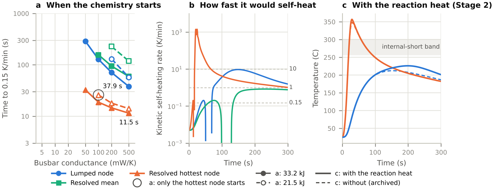

# Onset kinetics on a resolved neighbour cell: where a whole-cell threshold and a local one disagree

::: byline
Siddharth Satte, Independent researcher, Pune, India, 12 October 2026. A pre-registered pilot: predictions commits b09ef1d (Stages 1, 2) and 2657aee (Stage 3), each public before its kinetics ran on an archived history. [doi.org/10.5281/zenodo.23279456](https://doi.org/10.5281/zenodo.23279456){.nobr}; [github.com/siddharth161204-wq/m50-neighbour-onset-kinetics](https://github.com/siddharth161204-wq/m50-neighbour-onset-kinetics){.nobr}.
:::

1. With copper busbars (500 mW/K in all) and the largest Databank energy (33.2 kJ), the resolved neighbour's hottest node starts to self-heat at 0.15 K/min 23.4 and 26.4 s before the lumped node (10 and 30 s releases); under the posterior-mean B-CRNN kinetics of Koenig, Zhao and Deng each start is a fresh SEI decomposing at 108.4 C.
2. The smallest busbar conductance at which only the local chemistry starts is 100 mW/K under those kinetics (21.5 kJ).
3. Over 200 draws of their kinetic posterior the lumped node never starts first in any of the 42 cases; at 33.2 kJ, 30 s and 500 mW/K the lead runs from 15.4 to 58.9 s (2.5 to 97.5 %, median 26.3 s).
4. There, over the published spread of the roll's conductivity and heat capacity the hottest node's onset varies 0.027 times as much as over the kinetic posterior (standard deviations; the lumped node's 0.11 times): the kinetics set both.

Figure 1. (a) First time each history self-heats at 0.15 K/min, 30 s release, 33.2 kJ (filled) and 21.5 kJ (hollow); ringed where only the hottest node starts. (b) Kinetic self-heating rate along the three histories, 33.2 kJ, 30 s, 500 mW/K; gaps: net endothermic (separator melting). (c) With the reaction heat (solid) and without (dashed): the hottest node enters the internal-short band at 19.2 s either way; the lumped node peaks at 226 C.

## Method

1. Kinetics: the B-CRNN of Koenig, Zhao and Deng (Chem. Eng. J. 507 (2025) 160402), averaged over its trained particles: three NCM811 cathode, seven anode-electrolyte-SEI-binder and one separator reaction, at their cell's reactant mass fractions.
2. Checks against the source: their DSC curves at 5 C/min are reproduced; our emulation of their ARC test gives T~in~ = 179.3 C, inside their main-cluster band of 169.0 to 198.0 C, but T~on~ = 199.8 C at their stated 1 C/min trigger, below their band of 255.7 to 302.1 C.
3. Stage 1, passive: BDF along three archived 0.5 s histories (hottest node, resolved mean, lumped node) of the 49 cases of the two-cell study (doi:10.5281/zenodo.23253738). Stage 2, reactive, one-way, five cases: the reaction heat fed into its solver.
4. Stage 3: 200 joint draws of the posterior's particles on nine cases (42 for P3); 30 Latin hypercube draws of the roll's conductivities and specific heat (O'Regan et al. 2022; Chen et al. 2021) in the published solver; 210 pairs (Figure 2, README).
5. Checks: halving tolerances, steps and grids moves the onsets by at most 7 × 10^−5^ of themselves; energy accounts close to 10^−11^ at the published conductivities; with a 10^4^ W/mK roll resolved and lumped agree within 0.8 K.

## Limits

1. The kinetics come from other cells (NCM811 and graphite DSC data, not the M50's silicon-graphite negative). The SEI is fresh; the mean model decomposes it even at 25 C, and with it gone the lead grows to 60 s (exploratory).
2. Stage 1 ignores the reaction heat; Stage 2 is one-way; conduction and radiation only, so ejecta, flame and venting are excluded and none of this is propagation. The internal short is the source's T~on~ band as a temperature, not a model; at its own 1 K/min trigger the lumped node would short too.
3. One geometry without the cap and tabs, constant properties, and a hottest node that is the envelope of local histories.
4. Stage 3 treats the three submodels' particles as independent; its thermal ranges are literature spreads, not measured uncertainties of this cell (contact, busbar, emissivity fixed); its ARC check failed the brief's acceptance, passing only as amended.

## Prediction scorecard

| | Prediction | Result | Measured |
|---|----------------------------------------------------|---------|------------------------------------|
| P1 | Hottest node over half the lumped time earlier | Held | 85 and 70 % earlier (central 86, 71 %) |
| P2 | The resolved mean starts in exactly 10 named cases | Held | The same 10 |
| P3 | Smallest only-local conductance 100 mW/K | Held | 100 mW/K; also 8.75 kJ at 500, as named |
| P4 | Hottest node at 10 K/min, lumped under 1 K/min | Held | In the 4 named cases |
| P5 | Stage 2: (a) only the hot spot shorts; (b) at 200 mW/K too; (c) neither at 21.5 kJ | (b) failed | (a), (c) held; (b) +0.6, +0.7 K (central 5 to 10 K) |
| | **Stage 3** (33.2 kJ, 30 s, 500 mW/K; P3 over the 42 cases) | | |
| P1 | Hottest node first in over 95 % of draws | Held | 100 % (central 99 %) |
| P2 | 95 % onset interval: hottest under 20 s, lumped over 20 s | Held | 9.3 and 52.9 s (central 8 and 40 s) |
| P3 | Only-local conductance 100 mW/K in over half, never above 200 | Failed | 21 %; 500 mW/K in 10.5 % |
| P4 | Hottest onset: thermal SD over 1.5 times kinetic | Failed | 0.027 (central 3) |
| P5 | Lumped onset: kinetic SD over 1.5 times thermal | Held | 9.5 (central 2) |
| P6 | Under 10 % start below 100 C (early SEI) | Failed | 36.5 %, in all nine cases |

## Stage 4 (v1.1)

1. Each of the posterior's three submodels varied alone over the same 200 draws, the other two at their posterior mean (a choice; the joint draws stay the headline); 33.2 kJ, 30 s, 500 and 100 mW/K; predictions commit a975f20.
2. The anode-electrolyte submodel, holding the SEI, carries essentially all of the variance: 0.997 of the lead's at 500 mW/K (0.89 to 1.09 for every output at both); NCM811 cathode 0.000, separator at most 0.002.
3. With it at its mean no draw starts below 100 C; varied, 37.5 % do.
4. Its central half (a parameter-space proxy for a tighter posterior, on all 57 varying parameters) narrows the lead's 95 % width only from 43.5 to 37.1 s (14.6 %); on the SEI's own parameters, 18.1 %.
5. Exploratory: the lead has two modes (starts by 122.4 C, or at 184.9 C and above) and a tighter posterior keeps both; in marginal draws the SEI's heat net of the separator's melting sets the mode.
6. Scorecard: P1 (SEI submodel over half the lead's variance) held, 0.997 (central 65 %); P2 (shares sum to 0.8 to 1.1) held, 0.998; P3 (under 5 % below 100 C) held, 0 %; P4 (over 40 % narrower) failed, 14.6 %; P5 (same ranking at 100 mW/K) held.

## What it means for the thesis

Under DSC-trained kinetics a neighbour heated through copper busbars at 33.2 kJ starts to react where the busbar enters, before a lumped model in all 200 draws of the kinetic posterior (by 15 to 59 s in 95 % of them at the 30 s release); the uncertain kinetics, not the roll's published properties, set when. Next: an aged SEI in a resolved, two-way coupled cell with the cap and tabs.

Credit: The Battery Failure Databank is provided by the U.S. Department of Energy's National Renewable Energy Laboratory, operated by Alliance for Sustainable Energy, LLC (DOE/NREL/ALLIANCE); its notice accompanies the rows used, in inputs/databank/.

